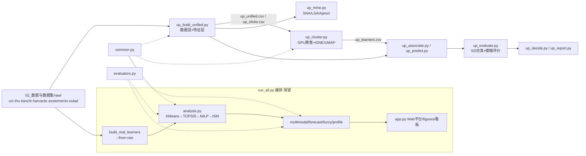

## 产品概述
将用户自研的单入口 9 阶段学习行为分析管线（`main.py`，含 GPU 加速）与同事的交付项目（`选题7_最终交付/03_源代码`，run_all.py 子进程编排 + OULAD 主链 + Web 平台）合并为一套可协同运行的系统。

## 用户已确认的四项决策
1. **骨架**：以同事的 `run_all.py` 编排为骨架，把 `main.py` 的 9 阶段封装成独立脚本接入编排链，数据通过文件传递；
2. **去重**：AHP/熵权/TOPSIS/模糊评价以同事实现为准；聚类与选 K 以用户的 GPU `ClusterEngine` 为准；
3. **数据组织**：`02_数据与数据集/raw/` 下按来源分子目录（uci/、thu_shortvideo/、tianchi/、harvardx/、assistments/、oulad/），派生表保留在根层级；
4. **OULAD**：接入统一管线，作为第 6 类真实数据源参与全管线聚类/预测。

## 核心功能
- 保留 GPU 加速（ClusterEngine：cuML/PyTorch CUDA/CPU 三级回退，`--device` 参数贯通全链）；
- 保留双方全部功能：用户侧 SNA/LSA/Apriori/场景对比/SD 仿真/规则队列/t-SNE+UMAP，同事侧 multimodal 四形态/MILP 预算决策/ISM/SES+Holt 预测/Web 平台/HTML 看板/改参重跑；
- 大文件不入 git（raw 数据目录进 .gitignore）。


## 技术方案

### 架构决策
- **编排层**：扩展 `run_all.py`（子进程串行、失败即停语义不变），新增 `--device auto|cpu|gpu` 与 `--skip-unified` 参数；在同事原 8 步之前/之后插入统一管线脚本组（`up_` 前缀，避免与已有 `analysis.py` 冲突）；
- **公共库**：新建 `common.py`（SEED/字体/调色板/路径常量/detect_device/ClusterEngine/绘图工具去重）与 `evaluators.py`（从 analysis.py L376-427 迁出 ahp/entropy_weight/topsis，同事实现原样迁入，analysis.py 与 multimodal.py 改为 import，消除两处重复）；
- **聚类统一**：analysis.py 与 multimodal.py 中的两套 KMeans+silhouette 改调 `ClusterEngine`，保留同事的匈牙利匹配画像命名与 k=4 主线口径；
- **数据传递**：统一管线各阶段产物落盘 `04_运行结果/up_*.csv|json`，与同事的 JSON 流并列；
- **数据适配**：`main.py` 的 5 个适配器抽到 `up_adapters.py`，路径改为指向 `02_数据与数据集/raw/`；新增 `load_oulad`（参考同事 build_real_learners.py 的聚合逻辑，映射统一 schema 并产出事件流）；
- **兼容性**：所有新模块加 `from __future__ import annotations`；同事代码要求 scipy≥1.10/sklearn≥1.3（Python 3.8 可满足，需在 pytorch-gpu 环境核验/补装）。

### 系统架构图


### 目录结构
```
选题7_最终交付/
├── 02_数据与数据集/
│   ├── raw/                          # [NEW] 按来源分类的原始数据（gitignore）
│   │   ├── uci/  thu_shortvideo/  tianchi/
│   │   ├── harvardx/  assistments/  oulad/
│   ├── real_learners.csv 等派生表     # [保留] 根层级不变
│   └── README.md                     # [MODIFY] 数据来源/下载/布局说明
├── 03_源代码/
│   ├── common.py                     # [NEW] GPU引擎/路径/绘图工具去重
│   ├── evaluators.py                 # [NEW] ahp/entropy_weight/topsis 唯一实现
│   ├── up_adapters.py                # [NEW] 5+1 数据源适配器（指向 raw/）
│   ├── up_build_unified.py           # [NEW] 统一数据层+特征层 → up_unified.csv/up_clicks.csv
│   ├── up_cluster.py                 # [NEW] GPU聚类+PCA/tSNE/UMAP → up_learners.csv
│   ├── up_mine.py                    # [NEW] SNA/LSA/时序/Apriori/场景
│   ├── up_associate.py               # [NEW] 相关/异质性/投入分层
│   ├── up_predict.py                 # [NEW] RF/GBDT/LogReg/早期预警/GM(1,1)
│   ├── up_evaluate.py                # [NEW] SD仿真（模糊评价调 evaluators）
│   ├── up_decide.py                  # [NEW] 规则队列/复核/推荐/优化建议
│   ├── up_report.py                  # [NEW] report.md 输出
│   ├── run_all.py                    # [MODIFY] 插入 up_ 链 + --device/--skip-unified
│   ├── analysis.py / multimodal.py   # [MODIFY] 聚类改 ClusterEngine、评价改 import evaluators
│   └── app.py / figures.py 等其余     # [保留]
├── 04_运行结果/                       # [MODIFY] 新增 up_*.csv|json 产物
└── README.md                         # [MODIFY] 合并说明与运行方式
```

### 关键接口（up_ 脚本统一约定）
```python
# 每个 up_ 脚本均为独立 CLI，统一约定：
# python up_xxx.py --raw-dir <02_数据与数据集> --result-dir <04_运行结果> --device auto
# 读上游落盘文件，写本阶段产物；失败 print + sys.exit(1)（保持 run_all 失败即停语义）
def main(argv=None) -> int: ...
```

### 性能与风险控制
- GPU 加速仅作用于 KMeans/轮廓系数/质心分配热点；RF 类保持 `n_jobs=-1`；GTX 1050 Ti（4GB）依赖既有分块策略；
- 同事主链重构（evaluators 抽取、ClusterEngine 替换）前后各跑一次 `run_all.py --check` + 全链比对 `04_运行结果/*.json`，保证结果逐位一致；
- OULAD 原始数据缺失时适配器安全跳过并记录日志（与现有适配器容错一致）；
- 大文件目录 raw/ 加入 .gitignore，派生表与代码正常入库。


## Agent Extensions
### SubAgent
- **code-explorer**
  - Purpose: 在重构同事模块前精确定位 analysis.py/multimodal.py/figures.py 中重复实现与调用点，及 run_all.py 编排细节
  - Expected outcome: 输出精确到行号的调用点清单，确保去重改造不遗漏、回归比对基准明确
