# 《系统工程原理》实践项目研究报告 — 选题 7

## 目　录

- 摘  要
- 1  问题界定
  - 1.1  研究背景与问题提出
  - 1.2  系统边界、要素与 CATWOE 根定义
  - 1.3  研究主线与章节安排
- 2  方法论与总体框架
  - 2.1  方法论选择：软起步、硬落地
  - 2.2  霍尔逻辑维七步的贯穿映射
  - 2.3  方法体系与技术路线
- 3  支撑数据与分析对象
  - 3.1  数据总体策略与双证据链
  - 3.2  多平台来源与三类形态覆盖
  - 3.3  字段对齐与维度覆盖
  - 3.4  OULAD 真实主表派生与质量评价
  - 3.5  描述统计与相关结构
  - 3.6  数据伦理与最小必要原则
- 4  系统建模
  - 4.1  目标体系与功能分解
  - 4.2  解释结构模型（ISM）
- 5  系统分析
  - 5.1  学习者画像：K-means 聚类与四类原型
  - 5.2  显性/隐性行为蕴含的六类画像维度
  - 5.3  画像发现与干预含义
- 6  系统预测
  - 6.1  早期预警时点识别
  - 6.2  无泄漏通过预测与行为归因
- 7  系统评价
  - 7.1  指标体系与组合赋权
  - 7.2  模糊综合评价
- 8  系统决策与优化建议
  - 8.1  0-1 整数规划模型
  - 8.2  求解结果与三方案对照
  - 8.3  跨形态干预组合决策
  - 8.4  分层优化建议与实施闭环
- 9  可验证成果与结论
  - 9.1  交互程序与模型—代码对照
  - 9.2  改参重跑与复现
  - 9.3  主要结论与展望
- 参考文献
- 附录 A  数据说明
- 附录 B  生成式 AI 使用声明表
- 附录 C  代码清单
- 附录 D  组员工作量与贡献度说明

## 摘  要

慕课、微课与短视频改变了学习模式，访问与观看日志既记录显性行为，也折射兴趣与习惯。如何从异构数据识别画像、发现规律并转化为平台可执行的改进措施，是本文要回答的问题。

本文以系统工程方法论为主线，按“数据对齐—建模—分析—预测—评价—决策”构建框架，以霍尔逻辑维七步组织各环节、CATWOE 界定边界。研究使用两条并重的真实证据链：英国开放大学数据集（OULAD）派生的 20,105 条课程级记录，回答“课程能否通过”；清华 FIB 短视频的 6,654 名国内用户与天池微课样本，结合学堂在线等平台共 9,236 条多形态记录，回答“内容为何被持续观看”。两条链各有标签语义，分层建模、不混算。

结果表明：四类画像通过率呈 86.7% 至 0.9% 梯度，第 4 周即可有效预警，无泄漏预测 AUC 为 0.8403；国内短视频完成度随年龄单调上升（20—24 岁 43.1%，65 岁以上 50.0%，p<0.001），性别、倍速与预习差异不显著，“倍速提效”缺乏数据支持；加入形态项后 AUC 由 0.808 升至 0.908，说明跨平台数据不可简单拼接。给定预算下，课程层与多形态层最优组合较经验法分别提升 59.7% 与 179.0%。

据此提出以可干预行为为抓手、兼顾课程参与与内容黏性、按画像分层帮扶、实施后再评价的建议。

关键词：线上学习行为；系统工程；学习者画像；无泄漏预测；干预优化

## 1  问题界定

### 1.1  研究背景与问题提出

慕课、微课与短视频的普及，使学习行为的发生场景从固定物理课堂迁移到时间与空间可自由分割的数字环境。这一迁移带来两个直接后果：其一，行为颗粒度显著细化，一次登录、一段观看、一次暂停、一道测验作答都可被记录为带时间戳的事件；其二，学习者异质性被充分暴露，同一门课程的学习者可能分布在不同地区、处于不同教育阶段、拥有完全不同的时间预算与设备条件。

登录时间、选课数量与类别、学习时长等数据，既记录了学习者的显性行为，也留下兴趣、习惯与背景的线索。把这些线索组织起来，可以在不掌握个体身份的情况下描述其画像与行为规律；再比较不同地区、背景学习者之间的差异，就能把群体分得更细，让教师与平台的措施更有针对性。据此，本文把研究问题界定为三个相互关联的子问题：跨形态、跨平台异构数据如何对齐为可比较的分析对象；如何从行为数据中辨识画像、识别影响因素并作预测与评价；如何把评价结论转化为有预算约束、可解释、可复验的干预决策。

现有研究多沿“数据—算法—结论”的直线路径推进，存在三点不足：分析对象缺乏系统界定，样本常取自单一平台；指标选取服从数据可得性而非目标导向，导致高相关特征被误读为成因；模型结论与管理决策之间缺少回路，预测准确率止步于模型报告。本文以系统工程方法论回应上述不足，并把方法使用限制在每一环节的合理性论证之内。

### 1.2  系统边界、要素与 CATWOE 根定义

研究对象不是线上学习平台本身，而是“学习者—资源—平台—环境”相互作用形成的行为系统。系统输入为地区、教育背景、性别等背景属性与平台日志；转换过程为选课、访问、观看、测验、交互等行为的累积；系统输出为画像类别、成效代理与干预建议；环境约束包括数据隐私规范、网络条件与学习者时间预算。

**表 1  CATWOE 根定义六要素**

| 要素 | 本文对应内容 | 对建模的约束 |
| --- | --- | --- |
| C 客户 | 学习者、教师、平台运营方、用人机构 | 目标多元，不能只用完成率单一指标 |
| A 行动者 | 教师、助教、平台运营与算法推荐机制 | 干预手段必须落在行动者可控范围 |
| T 转换过程 | 潜在学习者 → 持续参与并达成目标的学习者 | 以行为序列而非一次性快照刻画 |
| W 世界观 | 优质教育资源应突破地域与时空限制 | 关注地区与背景差异，避免平均化 |
| O 所有者 | 平台运营方与课程提供方 | 数据使用需授权，结论服务运营改进 |
| E 环境约束 | 隐私规范、网络条件、时间预算、设备条件 | 最小必要采集，脱敏后建模 |

> 注：根定义决定“软起步、硬落地”的两段式处理：问题界定承认目标多元，建模阶段在边界内使用定量工具。

*图 1  学习者行为系统边界与输入输出*

基于根定义可导出三层次目标：平台层追求规模与留存的可持续，表现为活跃比例、完成率与续选率；教师层追求教学有效性与干预及时性，表现为投入水平、掌握增益与困难识别前置性；学习者层追求学习收益与时间成本的匹配，表现为目标达成度与体验满意度。三层目标存在冲突：提高提醒频次可能短期提升活跃，却加剧时间压力并抬高长期流失风险，因此需把弱冲突转化为约束条件，而非简单提高活跃目标权重。

### 1.3  研究主线与章节安排

全文按“数据对齐—系统建模—系统分析—系统预测—系统评价—决策优化”展开，每一类系统工程方法单独成章，章节安排如下。

- 第 1—2 章界定问题并建立方法框架，以霍尔逻辑维七步作为唯一骨架，说明每一步为何选用相应方法。
- 第 3 章交代两条并重的真实证据链：OULAD 课程级数据与国内短视频、微课组成的多形态数据，逐项对应地区、教育背景、性别、访问时间、内容类别与终端标签等字段。
- 第 4 章为系统建模：先分解目标体系与功能模块，再用 ISM 把八项影响因素整理成可计算的递阶结构。
- 第 5 章为系统分析：课程侧以 K-means 形成四类行为画像；国内数据侧围绕短视频的兴趣、城市等级、城乡、性别、年龄、时段与天池终端标签做画像与差异检验，两侧并重、分层呈现。
- 第 6 章为系统预测：以第 4 周早期预警与无泄漏通过预测刻画行为—成效关联。
- 第 7 章为系统评价：以 AHP—熵权组合赋权与模糊综合评价形成可解释的评价结论。
- 第 8 章为系统决策与优化：把评价结论输入 0-1 整数规划，得到有预算约束的最优干预组合与三类对象的分层建议。
- 第 9 章给出可交互、可改参、可重跑的验证程序，并总结主要结论与局限。

## 2  方法论与总体框架

### 2.1  方法论选择：软起步、硬落地

霍尔三维结构把系统工程活动分解为时间维、逻辑维与知识维：逻辑维描述解决一个问题所经历的思维步骤，具有跨领域普适性。切克兰德指出，当系统涉及人的目标、价值判断与认知差异时，“寻求最优解”的硬系统假设往往不成立，应以“学习与比较”代替“优化”。线上学习行为系统同时具备两类特征：一方面，登录、观看、测验等日志是可观测、可量化的硬数据；另一方面，“学习目标达成”“教学质量”“有意义的交互”等概念本身多元且存在价值判断，属于软问题。

因此本文采取两段式处理：问题界定阶段使用软系统方法，承认目标多元，通过利益相关者分析与 CATWOE 构建各方可接受的根定义；建模、评价与决策阶段转入硬系统方法，在根定义划定的边界内使用 ISM、无泄漏预测、组合赋权与 0-1 规划等定量工具。WSR（物理—事理—人理）所强调的“是什么—怎么做—应当怎样”已分别落入数据、模型与目标三层，不再单列映射。这一分工避免两种常见偏差：纯粹软方法使研究停留在概念图层面，缺乏可检验结论；纯粹硬方法使模型精致但问题错位，把可计算的指标误当作真正的目标。

### 2.2  霍尔逻辑维七步的贯穿映射

霍尔逻辑维包含七个步骤。本文把七步逐一落到章节、方法与输出，形成可核对的主线（表 2），使研究链条闭合。

**表 2  霍尔逻辑维七步 ↔ 章节 ↔ 方法 ↔ 输出**

| 逻辑维步骤 | 落点章节 | 使用方法 | 主要输出 |
| --- | --- | --- | --- |
| ①明确问题 | 1.1—1.2 | 现状说明、系统边界、CATWOE | 系统边界图、根定义表 |
| ②选择目标 | 4.1 | 目标树、冲突协调（弱冲突转约束） | 三层目标体系 |
| ③系统综合 | 4.2、8.1 | ISM 递阶、多方案生成：画像簇 × 干预强度 | 五级递阶、四类画像、24 个干预候选单元 |
| ④系统分析 | 第 3、5 章 | 数据对齐、画像与六维差异检验 | 画像表、六维差异检验结论 |
| ⑤方案优化 | 第 6—8 章 | 无泄漏预测 + 组合赋权评价 + 0-1 规划 | 最优组合与三方案对照 |
| ⑥作出决策 | 8.4 | 分层干预矩阵、实施闭环 | 三类对象建议 |
| ⑦付诸实施 | 第 9 章 | 可验证程序、改参重跑、再评价 | 交互式成果、复现记录 |

> 注：七步不是线性流水线：第 7 步的再评价用于检验前六步的结论，并为回置到第 4.2 节 ISM 邻接矩阵与第 7.1 节 AHP 判断矩阵提供条件。本报告完成的是可复现的离线验证，实际回置须在平台 A/B 测试取得干预结果后执行，详见 9.3 展望。

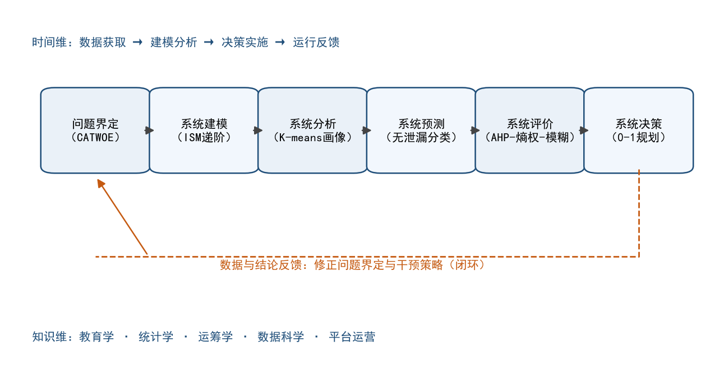

*图 2  整体技术路线：七步主线与双证据链*

### 2.3  方法体系与技术路线

围绕上述主线，本文保留五类直接服务于研究目标的方法，各自单独成章：系统建模把目标与因素关系转成可计算结构，系统分析用于画像与群体差异识别，系统预测用于判断“能否干预、何时干预”，系统评价给出可比较的运营诊断，系统决策用于形成有预算约束的资源配置方案。各类方法均有实跑证据（表 3）。

**表 3  方法体系与实跑证据**

| 方法类别 | 本文实现 | 实跑证据 | 所在章节 |
| --- | --- | --- | --- |
| 系统建模 | 目标树 + ISM 递阶结构 | 五级递阶；S2、S4 为根源因素 | 第 4 章 |
| 系统分析 | 课程侧 K-means 画像 + 国内短视频/微课多维差异检验 | 四类画像轮廓 0.368；国内年龄梯度 p<0.001、倍速 p=0.768 | 第 5 章 |
| 系统预测 | 早期预警 + 无泄漏预测 + 跨形态迁移检验 | 第 4 周 AUC=0.762；无泄漏 AUC=0.8403；形态项增益 0.100 | 第 6 章 |
| 系统评价 | AHP—熵权组合 + 模糊综合评价（含国内形态） | CR=0.0074；国内微课/短视频等级诊断 | 第 7 章 |
| 系统决策 | 0-1 整数规划 + 三方案对照（含国内形态单元） | 课程层 +59.7%；多形态层 +179.0% | 第 8 章 |
| 系统实施 | 交互式程序、上传 CSV、改参重跑 | 三组改参快照与差异数字 | 第 9 章 |

> 注：扩展方法（短期趋势外推、跨形态迁移测评、TOPSIS 交叉验证、预算扫描与系统动力学反馈）的结果以注记或结果文件形式保留，不构成本文方法主线。

## 3  支撑数据与分析对象

### 3.1  数据总体策略与双证据链

本研究坚持真实数据实证、不含仿真样本，并以两条并重的证据链支撑分析。第一条是课程级证据链：OULAD 是英国开放大学（The Open University）发布的在线学习分析公开数据集（Open University Learning Analytics Dataset），记录该校慕课学习者 2013—2014 学年的选课、逐日点击与考核结果。本文由其派生的 20,105 条真实记录（18,634 名学习者、13 门课程），含地区、教育背景、性别、年龄、点击行为与真实结业标签，回答“哪些行为导致课程通过”，支撑第 5 章画像、第 6 章预测、第 7 章评价与第 8 章决策。第二条是国内场景与内容级证据链，以短视频和微课为主体：清华 FIB 实验室 WWW 2025 短视频数据集的 6,654 名用户（覆盖国内 365 座城市）提供城市等级、城乡、性别、年龄、时段与内容偏好等细粒度属性，阿里云天池高校慕课样本提供倍速、设备、网络与预习标签；与 edX、学堂在线等平台对齐后共 9,236 条多形态样本，回答“什么内容被持续观看、在什么终端与时段被观看”，支撑第 5.2.4—5.2.6 节画像、第 7.2 节评价与第 8.3 节决策。两条链在分析地位上并重、在结论上互补，各数据源见表 4。

之所以坚持双链而非单一数据集，是因为两条链各有不可替代之处：OULAD 有真实结业结果却只有日粒度行为、缺少内容维度；国内短视频与微课有小时级时段、内容类别与终端标签，却只有 7 日或章节级窗口、标签为行为持续性代理。二者结合才能同时覆盖“学习结果”与“学习过程”。两类数据的标签语义与观察窗口不同，只在各自口径内解释，不做跨口径的绝对值拼接。所有派生口径（等效学习时长、观看完成度等）均在附录 A 与 real_learners_meta.json 中声明；随机种子 20260101 仅控制 KMeans 与交叉验证的可复现性，不参与数据生成。

### 3.2  多平台来源与三类形态覆盖

依据形态特征与数据可得性，最终纳入六源真实数据，覆盖 MOOC（课程级/学期尺度）、微课（章节级微资源会话）、短视频（单条知识内容/7 日窗口）三类线上形态，并以 UCI #320 传统课堂数据作为零在线对照端点。为避免缩写与机构名称引起误解，逐项说明如下：MOOC 样本由 edX（美国 HarvardX/MITx）、OULAD（英国开放大学）与学堂在线（XuetangX，中国）三个平台对齐而成；微课样本是阿里云天池发布的“中国高校慕课课程多维画像与学习行为脱敏样本”，取自国内高校慕课平台的章节级微资源会话；短视频样本来自清华大学 FIB 实验室发布的WWW 2025 移动短视频行为、属性与内容公开数据集，按教育、科学、读书、历史四类知识内容筛选——该数据集由学术机构脱敏后公开，发布方未标注具体商业 App 名称，本文不将其指认为任一具体平台；课堂对照为 UCI 第 320 号数据集（葡萄牙两所中学的成绩单），不含任何在线行为日志，仅作零在线端点。所有平台与机构名称、原始下载地址、许可条件见附录 A 与数据源清单。

**表 4  六源真实数据与四类形态样本**

| 形态 | 数据源 | 分析单元 | 样本量 | 标签语义 | 正例率 |
| --- | --- | --- | --- | --- | --- |
| MOOC | HMXPC13 (edX) / OULAD / KDD Cup 2015 学堂在线 | 人—课 | 6,000 | 取得认证 / 通过（结果性标签） | 0.1895 |
| 微课 | 中国高校慕课课程多维画像与学习行为脱敏样本（阿里云天池） | 人—课（章节级微资源会话） | 723 | 单元测验通过 is_passed（过程—结果性标签） | 0.8520 |
| 短视频 | 清华 FIB 实验室 WWW 2025 移动短视频行为、属性与内容数据集 | 用户 × 7 日观测窗口（前 5 日特征 → 后 2 日标签） | 1,469 | 后 2 日知识类内容回访（按时间切分的行为持续性标签） | 0.1967 |
| 课堂对照 | UCI #320 Student Performance（葡萄牙两所中学） | 人—学科（传统课堂） | 1,044 | 期末成绩 G3 ≥ 12（结果性标签，无在线行为） | 0.4885 |

> 注：四类标签语义不同，只作同构代理，不作跨形态的绝对值比较；课堂对照不参与线上干预预算。

数据源合理性裁定：天池样本按章节微资源会话记录，中位资源时长 6—7 分钟，符合微课“短、小、碎、可独立成单元”的定义；清华 FIB 数据发布时间新、含停留时长与完播状态，但其采样窗口仅 7 天，因此标签设为“前 5 日行为 → 后 2 日回访”而非完课率；UCI #320 无在线行为，只用于校验“零在线端点”在模型中的表现；EduData 集成包作为备选未入模，避免多源重复样本造成隐性加权。

同一数据源在不同分析环节采用不同口径，需在此说明以免混淆：短视频的预测与评价使用按“前 5 日特征—后 2 日标签”切分并筛选后的 1,469 条用户×窗口样本（表 4），属性画像则使用该数据集的全部 6,654 名用户（5.2.4—5.2.5）；天池微课的预测样本为 723 条人—课记录，倍速与预习画像覆盖其中 715 名学习者、2,614 条视频播放事件。这些数字是同源数据的不同切分与聚合，不是彼此矛盾的样本量，各口径均在来源文件中标明。

*图 3  三类线上形态与课堂对照的样本结构与成效代理率*

### 3.3  字段对齐与维度覆盖

研究涉及地区、教育背景、性别、访问次数、访问时间、选课情况、学习时长等维度。现实约束是没有任何单一公开数据集覆盖全部字段，因此采取“形态内取交集、形态间不强行插补”的策略，并把字段可得率作为数据质量证据写入附录 A。对应关系见表 5。

**表 5  研究维度 ↔ 真实数据来源对应**

| 研究维度 | OULAD 主表字段 | 多形态数据对应 | 覆盖说明 |
| --- | --- | --- | --- |
| 地区 | region（13 类，已译中文） | UCI 学校；天池脱敏地区 | 课程链完整覆盖 |
| 教育背景 | education（5 类） | 清华用户属性 | 课程链完整覆盖 |
| 性别 | gender（男/女） | OULAD/UCI/清华用户属性 | 课程链完整覆盖 |
| 访问次数 | visit_count（真实 sum_click 聚合） | 天池访问；短视频点击 | 三类形态均覆盖，口径按单元归一 |
| 访问时间 | first_active_lag / 前期窗口 | OULAD date；天池 timestamp；清华点击时间 | 用于时间切分与早期预警 |
| 选课情况 | course_id（code_module+学期，13 门） | 学堂在线课程 ID | 课程链完整覆盖 |
| 学习时长 | study_hours / avg_session_min（点击折算代理） | 天池观看时长；清华停留时长 | 口径不同，已声明代理性质，形态内标准化后使用 |

> 注：字段口径差异以“形态内 z-score + 缺失指示变量”处理；跨形态只比较标准化后的五维共享指标。

### 3.4  OULAD 真实主表派生与质量评价

课程级证据链由 build_real_learners.py 从 OULAD 五张原始公开表派生：studentInfo（人口属性与 final_result）、studentVle（1,065 万条点击日志）、vle（资源类型）、studentAssessment 与 assessments（提交与得分）。仅取 2013J / 2014J 两个标准 12 周学期以保证窗口一致，派生出 20,105 条学习者—课程真实记录。标签 certificate=(final_result∈{Pass, Distinction}) 直接取真实学业结果，不由输入行为派生；预测特征严格限定在第 4 周之前的行为与人口属性，杜绝“用结果预测结果”。等效学习时长与资源覆盖度为点击折算代理，口径已在 real_learners_meta.json 声明，不冒充真实计时。

**表 6  OULAD 真实主表质量六维评价**

| 维度 | 得分（%） | 说明 |
| --- | --- | --- |
| 完整性 | 100.00 | 清洗后无缺失 |
| 一致性 | 100.00 | active_days≤visit_count 逻辑校验通过率 |
| 唯一性 | 100.00 | 学习者—课程键唯一 |
| 有效性 | 100.00 | 比率/分值取值域校验通过 |
| 时效性 | 100.00 | 两学期观察窗口一致 |
| 代表性 | 100.00 | 13 门真实课程全样本 |

> 注：本表评价对象是清洗后的交付主表 real_learners.csv，六项均为派生校验口径：键唯一、比率取值合规、窗口统一，故达标记为 100，不代表 OULAD 原始日志无缺失。原始 studentVle 日志约 1,065 万条，经派生、去重与语义填补后得到 20,105 条主表；前期窗口 2,550 条无记录者按语义填 0（见表 7）。

**表 7  清洗前后关键计数**

| 指标 | 数值 | 指标 | 数值 |
| --- | --- | --- | --- |
| 原始记录 | 20,105 | 去重后 | 20,105 |
| 原始缺失单元 | 0 | 清洗后缺失 | 0 |
| 时长截断记录 | 0 | 学习天数>访问天数 | 0 |
| 学习者数 | 18,634 | 课程数 | 13 |
| 真实通过率 | 0.4940 | 女性占比 | 0.4457 |

### 3.5  描述统计与相关结构

真实样本的访问次数均值 473.32 次（标准差 596.46）、活跃天数均值 21.91 天、等效学习时长均值 0.79 小时，各变量变异系数较大，说明真实学习者异质性充分，适合画像与干预分层。行为变量之间存在中等程度相关，但未出现近乎共线的冗余对，可直接用于组合赋权；相关矩阵见 04_运行结果/results.json/corr。

**表 8  核心行为变量描述统计**

| 变量 | 均值 | 标准差 | 25% | 中位数 | 75% | 变异系数 |
| --- | --- | --- | --- | --- | --- | --- |
| visit_count | 473.32 | 596.46 | 64.00 | 268.00 | 634.00 | 1.260 |
| active_days | 21.91 | 19.24 | 6.00 | 18.00 | 34.00 | 0.878 |
| study_hours | 0.79 | 0.99 | 0.11 | 0.45 | 1.06 | 1.260 |
| avg_session_min | 1.65 | 1.23 | 0.83 | 1.47 | 2.28 | 0.747 |
| forum_posts | 117.24 | 269.11 | 0.00 | 32.00 | 126.00 | 2.295 |
| first_active_lag | 14.08 | 27.54 | 0.00 | 2.00 | 8.00 | 1.956 |

地区分布中苏格兰（11.4%）、东盎格利亚（10.1%）、南部（9.4%）居前；学历以 A-Level 或同等（43.3%）与低于 A-Level（40.0%）为主；性别女 44.6%、男 55.4%。真实分组间通过率呈合理梯度（研究生 65.2% > 高等教育 57.9% > A-Level 54.2% > 低于 A-Level 41.2%），印证人口属性作为分组变量的解释力。

### 3.6  数据伦理与最小必要原则

所有公开数据均已脱敏：用户 ID 为哈希或序号，教育/地区属性为粗粒度分箱；交付包只保留建模所需的聚合与标准化字段，不分发原始用户级明细与任何登录凭据。个体层面的预警结果限定用于支持性干预，不用于评价、排名或惩戒；数据使用范围、存储期限与访问权限需在制度层面明确。清华大学短视频数据集的登录信息未被写入任何代码、日志或文档，合规扫描结果见附录 A。

## 4  系统建模

### 4.1  目标体系与功能分解

依据第 1.2 节根定义，目标体系分三层展开：平台层目标为规模与留存可持续，分解为活跃率、完成率与续选率；教师层目标为教学有效性，分解为投入水平、掌握增益与困难识别前置性；学习者层目标为收益与成本匹配，分解为目标达成度、时间成本与体验满意度。三层的冲突通过约束转化处理：把“提醒频次提高”带来的时间压力作为长期副作用纳入第 8.4 节的实施闭环检验，而不是简单提高活跃目标权重。

在功能层面，总目标分解为数据接入、清洗对齐、画像辨识、风险预测、综合评价、干预决策六个模块，与第 9 章可验证程序逐一对应，保证叙述与实现可逐格核对。这六个模块构成本章建模的对象：先建立因素之间的递阶结构，再依次进入分析、预测、评价与决策环节。

### 4.2  解释结构模型（ISM）

系统建模先要解决“因素之间谁驱动谁”。ISM 把领域判断转成可计算的递阶结构：先识别八项影响因素 S1—S8 形成邻接矩阵 A，再按布尔规则计算 A+I 的幂直至不变得到可达矩阵 M，最后做区域与级别划分。

`M = (A + I)^k ,  (A + I)^k = (A + I)^(k+1)`　　(1)

> 式中：A 为邻接矩阵，I 为单位矩阵，k 为达到稳定所需的最小幂次；M_ij=1 表示因素 i 经若干步可影响 j。

*图 4  ISM 五级递阶结构与因素关联*

**表 9  ISM 级别划分结果**

| 层级 | 因素 | 含义 |
| --- | --- | --- |
| L1（顶层） | S8 | 直接表现为学习成效 |
| L2 | S7 | 交互参与的直接驱动 |
| L3 | S6 | 时间投入与学习节律 |
| L4 | S1、S3、S5 | 机制与动机条件 |
| L5（底层） | S2、S4 | 结构性根源 |

> 注：顶层为 S8 学习成效，底层为 S2 课程难度与内容设计、S4 先备知识与自我效能；机制类因素的位置与文献判断一致。MICMAC 驱动—依赖分类显示 S2、S4 驱动力最高而依赖度为零，属根源因素；S1、S3、S5 等中间层因素兼具驱动与依赖，是最可干预的杠杆。完整分类见 results.json/ism。

结构解释：位于中间层的平台资源质量、学习支持服务与交互参与是可干预性最强的杠杆，其变化可向下传导至成效；位于底层的先备知识与时间预算解释力强但难以短期改变。因此干预排序应按“可干预性”而非“解释力”，这一判断直接决定第 8 章候选方案集的构造。

## 5  系统分析

### 5.1  学习者画像：K-means 聚类与四类原型

画像采用真实数值行为特征标准化后的 K-means 聚类，并以类别属性（地区、学历、性别）作事后结构描述。之所以不让类别属性进入距离计算，是因为人口属性属于分组变量而非行为变量，若混入距离会造成属性污染行为。本文的处理等价于 K-prototypes 中类别权重 γ=0 的特例，既保留混合属性的可解释性，又避免属性污染行为。轮廓系数在 k=2—8 上扫描（k=3 时为 0.475、k=4 时为 0.368），最终取语义最清晰的 k=4；聚类标签与四类行为原型做匈牙利最小距离匹配，保证命名唯一。真实数据没有预设的潜在类别真值，故不计算 ARI，改以画像通过率的单调梯度与结构占比作为外部可解释性证据。

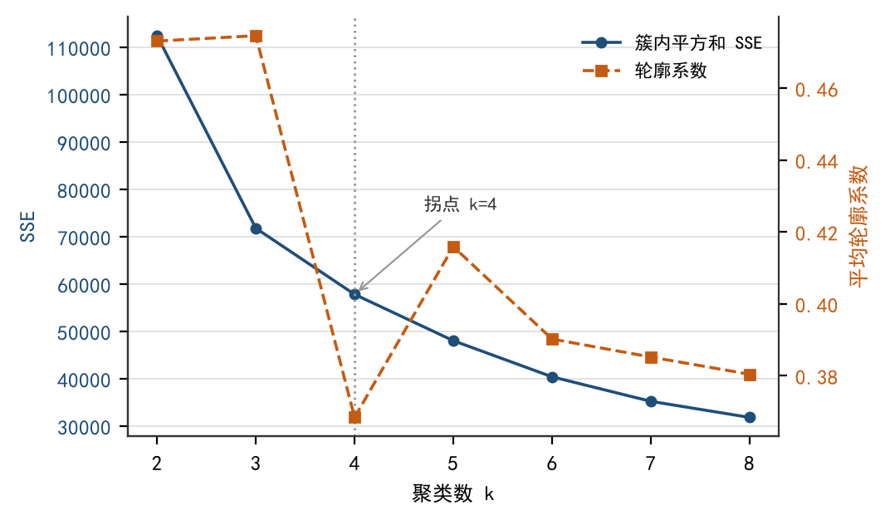

*图 5  K 值扫描：惯量与轮廓系数*

**表 10  四类学习者画像及结构特征**

| 画像 | 人数 | 占比 | 等效时长(h) | 访问次数 | 资源覆盖度 | 作业提交率 | 真实通过率 |
| --- | --- | --- | --- | --- | --- | --- | --- |
| 社交深耕型 | 1,176 | 5.8% | 3.80 | 2280.2 | 0.347 | 0.999 | 0.867 |
| 自主达标型 | 5,787 | 28.8% | 1.36 | 817.9 | 0.321 | 0.998 | 0.749 |
| 应试突击型 | 8,969 | 44.6% | 0.37 | 220.6 | 0.155 | 0.998 | 0.506 |
| 低投入游离型 | 4,173 | 20.8% | 0.05 | 29.5 | 0.028 | 0.001 | 0.009 |

> 注：画像来自 20,105 条 OULAD 真实记录；名称由与原型的最小距离唯一匹配得到。真实通过率呈 86.7%→74.9%→50.6%→0.9% 梯度，验证画像可解释性。等效时长为点击折算代理，非真实计时。

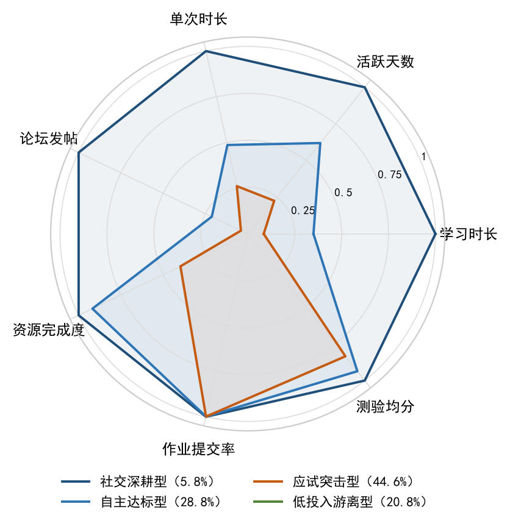

*图 6  四类画像的五维行为雷达图*

### 5.2  显性/隐性行为蕴含的六类画像维度

在线学习数据中的登录时间、选课数量与类别、访问与观看行为，既包含显性行为（访问、提交、互动），也包含隐性行为（时段偏好、停留节律、内容倾向）。本节针对实践中关心的六类画像维度——地区、专业背景、学习习惯、兴趣爱好，以及短视频用户属性（城市等级、性别、年龄、时段）与天池微课终端标签（倍速、设备、预习）——分别做可复核的群体刻画与差异检验，考察哪些维度真正携带群体信息。六类维度均由 profile_modeling.py 从真实数据实算，覆盖 20,105 条 OULAD 主表记录、6,654 名短视频用户与 715 名天池微课学习者，不含任何仿真样本。需要强调：群体差异均为观察性关联而非因果，且不用于个体评价或惩戒。

关于地域来源需作明确区分：前四类画像中的“地区”为英国开放大学 13 大区（locale，非国籍）；而短视频用户属性来自中国国内 365 座城市（含一线至五线城市等级），天池微课为国内脱敏样本。国内与英国数据分层呈现、不合并、不互推，避免把不同教育体系的口径混为一谈。

#### 5.2.1  地区差异

地区维度以英国开放大学学习者的地域分类（locale，共 13 类）为分组变量，比较各地区的参与强度与真实通过率。卡方检验显示地区与学业结果的关联在统计上显著（χ²=122.085，df=12，p<1e-6），但 Cramér’s V=0.0779 表明关联强度较弱；地区间访问次数的 Kruskal–Wallis 检验 H=205.71（p<1e-6）。这说明地区确实携带群体信息，但解释力有限，不能替代行为变量。

**表 11  地区分组的参与与成效对照（节选高/低各组）**

| 地区 | 样本数 | 占比 | 真实通过率 | 访问次数 | 活跃天数 |
| --- | --- | --- | --- | --- | --- |
| 爱尔兰 | 789 | 3.9% | 58.1% | 517 | 23.4 |
| 南部 | 1,883 | 9.4% | 53.7% | 499 | 22.9 |
| 东南 | 1,328 | 6.6% | 52.9% | 458 | 22.0 |
| 西米德兰兹 | 1,564 | 7.8% | 45.3% | 430 | 20.6 |
| 伦敦 | 1,883 | 9.4% | 44.9% | 449 | 20.3 |
| 西北 | 1,766 | 8.8% | 42.8% | 445 | 20.8 |

> 注：按真实通过率降序取前三与后三；全部 13 类见 profile_results.json。地区为英国地域分类，非国籍，不外推。

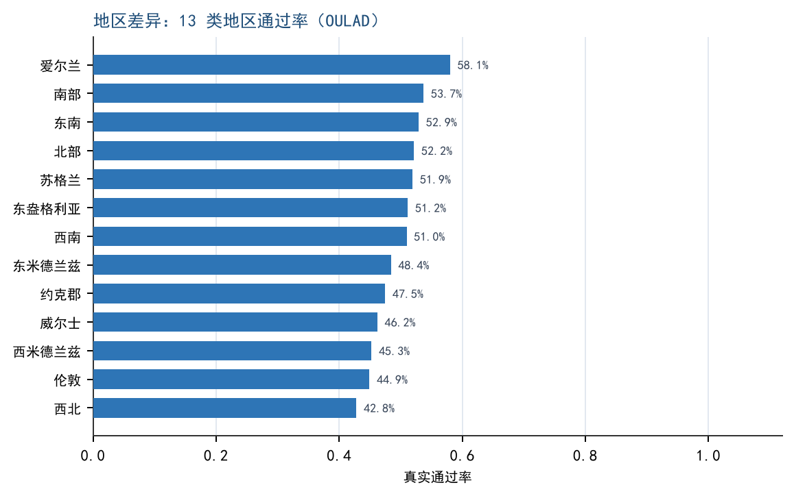

*图 7  13 类地区通过率对照*

#### 5.2.2  专业背景

专业背景以入学学历、所选课程模块（学科方向）与选课门数三类真实字段代理。数据集不含“专业”自陈字段，故本节结论限于代理口径。学历层次的通过率呈单调梯度：无正式学历 27.8%、低于A-Level 41.2%、A-Level或同等 54.2%、高等教育学历 58.0%、研究生学历 65.2%；卡方检验 χ²=438.371（p<1e-6）。选课门数方面，选 1 门者通过率 50.8%，选 2 门及以上者通过率明显更低（17.7%），提示多课程并发可能稀释投入，但需控制课程难度后进一步验证。

**表 12  学历层次与选课门数的成效对照**

| 代理维度 | 分组 | 样本数 | 占比 | 真实通过率 | 访问次数 |
| --- | --- | --- | --- | --- | --- |
| 学历 | 无正式学历 | 198 | 1.0% | 27.8% | 295 |
| 学历 | 低于A-Level | 8,048 | 40.0% | 41.2% | 432 |
| 学历 | A-Level或同等 | 8,703 | 43.3% | 54.2% | 473 |
| 学历 | 高等教育学历 | 2,975 | 14.8% | 58.0% | 590 |
| 学历 | 研究生学历 | 181 | 0.9% | 65.2% | 617 |
| 选课门数 | 1 门 | 17,195 | 85.5% | 50.8% | 477 |
| 选课门数 | 2 门 | 2,814 | 14.0% | 41.6% | 453 |
| 选课门数 | ≥3 门 | 96 | 0.5% | 17.7% | 402 |

> 注：课程模块为 OULAD 编码 AAA–GGG，原数据不提供学科中文名，故保留代码；七模块通过率 40.6%–71.0%。

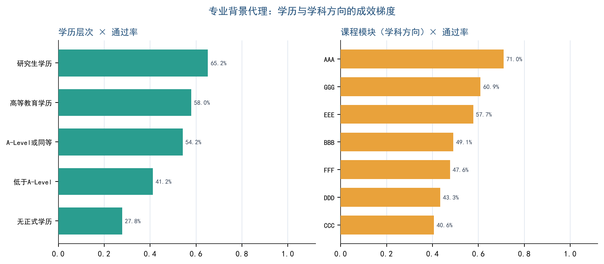

*图 8  学历与学科方向的成效梯度*

#### 5.2.3  学习习惯

学习习惯由启动滞后、活跃密度、单次时长与资源覆盖四项可解释阈值规则分为五型，与 5.1 节面向成效的 K-means 画像相互独立。“规律深耕型”占 36.2%、通过率 75.7%，“浅触即离型”占 36.0%、通过率仅 24.6%，分型与结果关联显著（χ²=4104.439，p<1e-6）。登录时间方面，短视频小时级数据显示观看高峰在晚间与下午；由于 OULAD 仅有日粒度，两类时段口径分层呈现、不直接合并。

**表 13  五类学习习惯分型的规模与成效**

| 习惯类型 | 人数 | 占比 | 真实通过率 | 启动滞后(天) | 活跃天数 | 单次时长(分) |
| --- | --- | --- | --- | --- | --- | --- |
| 规律深耕型 | 7,271 | 36.2% | 75.7% | 1.1 | 41.2 | 2.34 |
| 稳定参与型 | 1,415 | 7.0% | 63.7% | 1.3 | 32.4 | 1.26 |
| 晚到追赶型 | 320 | 1.6% | 67.5% | 11.4 | 28.6 | 2.06 |
| 碎片专注型 | 3,853 | 19.2% | 39.7% | 5.0 | 11.8 | 2.37 |
| 浅触即离型 | 7,246 | 36.0% | 24.6% | 34.6 | 5.5 | 0.63 |

> 注：启动滞后=注册日至首次 VLE 活跃日之差；阈值取自真实分布分位。口径为行为节律代理，非心理测量。

**表 14  短视频用户观看时段偏好（用户级主时段）**

| 时段 | 用户占比 |
| --- | --- |
| 晚间 (18-21) | 32.6% |
| 下午 (12-17) | 32.2% |
| 上午 (6-11) | 21.9% |
| 深夜 (22-23) | 9.4% |
| 凌晨 (0-5) | 3.7% |

> 注：基于 6,654 名短视频用户，取每人交互最多的时段为主时段；p_hour 为小时级真实字段。

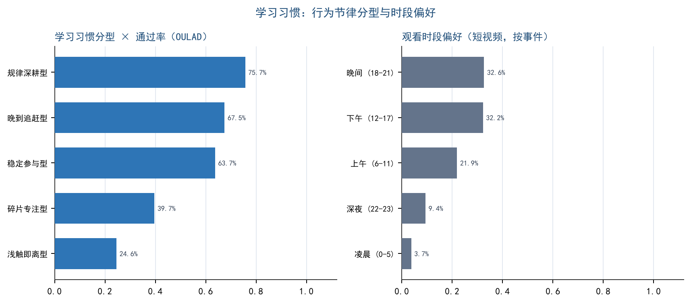

*图 9  学习习惯分型与时段偏好*

#### 5.2.4  兴趣爱好

兴趣爱好由短视频内容观看占比推断，属行为偏好代理而非心理测量。全体 6,654 名用户的观看时长集中于 影视和短剧 50.0%、搞笑 8.2%、美食 4.6%，覆盖 37 个一级类目。按知识类与娱乐类观看占比将用户划为三类兴趣画像：知识求知型 6.7%、均衡杂食型 63.3%、娱乐休闲型 30.0%。教育类内容子群的平均观看时长低于全平台均值，说明知识类内容更偏短时长、高强度浏览，符合短视频形态特征。

**表 15  三类兴趣画像的内容偏好对照**

| 兴趣画像 | 人数 | 占比 | 知识类占比 | 娱乐类占比 | 兴趣多样性 |
| --- | --- | --- | --- | --- | --- |
| 知识求知型 | 446 | 6.7% | 45.4% | 7.7% | 0.634 |
| 均衡杂食型 | 4,212 | 63.3% | 2.8% | 41.7% | 0.634 |
| 娱乐休闲型 | 1,996 | 30.0% | 0.6% | 93.4% | 0.365 |

> 注：兴趣多样性为归一化类目熵（0–1），越高表示涉猎越广。短视频内容偏好不等同学科兴趣，仅作人群描述。

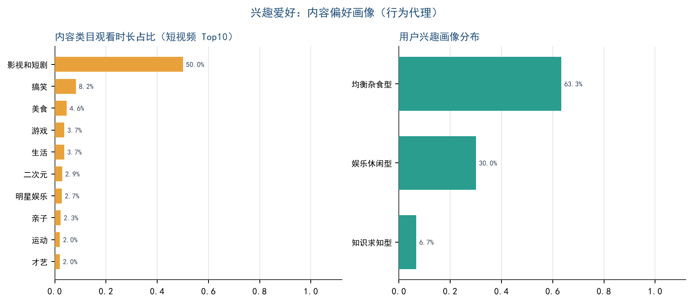

*图 10  内容偏好画像*

#### 5.2.5  短视频用户属性：城市等级、城乡、性别与年龄（国内数据）

短视频数据提供中国国内用户的人口属性与小时级时段，使画像从“行为代理”落到可解释的人群结构，这是相对 OULAD 日粒度数据的一项独特信息。本节覆盖 6,654 名用户、365 座城市。观看完成度定义为观看时长与视频时长之比（截断至 1），是行为持续性代理，并非真实完课率。检验统一采用 Kruskal–Wallis 秩和检验：该检验不要求正态分布，适合完成度这类有界且右偏的比例变量，以中位数差异而非均值差异判断组间区分度。

**表 16  城市等级用户的观看完成与互动（国内）**

| 城市等级 | 人数 | 占比 | 观看完成度 | 完整观看率 | 互动率 | 人均观看秒 |
| --- | --- | --- | --- | --- | --- | --- |
| 一线城市 | 295 | 4.4% | 45.9% | 30.1% | 58.2% | 47.8 |
| 新一线城市 | 733 | 11.0% | 45.0% | 29.8% | 58.8% | 45.8 |
| 二线城市 | 994 | 14.9% | 48.5% | 32.4% | 63.4% | 48.1 |
| 三线城市 | 1,548 | 23.3% | 48.0% | 31.8% | 63.4% | 49.3 |
| 四线城市 | 1,588 | 23.9% | 47.4% | 31.3% | 63.5% | 48.4 |
| 五线城市 | 1,490 | 22.4% | 46.0% | 30.3% | 62.1% | 49.0 |

> 注：城市等级为中国国内分层，与英国 OULAD 地区口径不同，不可合并比较。H=14.641，p=0.012，虽显著但完成度极差仅 3.5%，属“统计显著、实际效应小”，不宜据此单独设计差异干预。

年龄是最强的人口梯度：从最低龄组到最高龄组，观看完成度由 43.1% 升至 50.0%，人均观看时长由 38.1 秒增至 56.6 秒，近似单调；Kruskal–Wallis H=48.324（p<1e-6）。这与短视频使用研究中的年龄分化一致，但本数据是横截面观察，不能把年龄差异解释为随龄学习行为的变化。

**表 17  年龄分组的观看完成与互动（国内，全六档）**

| 年龄段 | 人数 | 占比 | 观看完成度 | 完整观看率 | 互动率 | 人均观看秒 |
| --- | --- | --- | --- | --- | --- | --- |
| 20–24岁 | 740 | 11.1% | 43.1% | 26.0% | 59.1% | 38.1 |
| 25–34岁 | 1,209 | 18.2% | 45.7% | 29.1% | 61.5% | 40.8 |
| 35–44岁 | 1,292 | 19.4% | 45.8% | 29.6% | 61.6% | 43.6 |
| 45–54岁 | 892 | 13.4% | 48.0% | 33.2% | 63.1% | 51.6 |
| 55–64岁 | 1,047 | 15.7% | 48.1% | 32.8% | 63.2% | 55.7 |
| 65岁以上 | 1,474 | 22.1% | 50.0% | 34.3% | 64.6% | 56.6 |

> 注：年龄为用户自陈属性；完成度与时长均为观看行为代理。梯度仅作人群描述与内容分层参考，不作因果推断。

城乡维度补充了城市等级之外的信息：乡村用户占 33.5%，观看完成度 47.4%、互动率 63.3%，均高于城区用户的 44.6% 与 58.9%。这一方向与“下沉市场黏性更强”的观察一致，提示内容分发不应只按城市能级配置资源。

**表 18  城乡用户的观看完成与互动（国内）**

| 城乡类型 | 人数 | 占比 | 观看完成度 | 完整观看率 | 互动率 |
| --- | --- | --- | --- | --- | --- |
| 乡村 | 2,228 | 33.5% | 47.4% | 31.1% | 63.3% |
| 城区 | 1,324 | 19.9% | 44.6% | 28.6% | 58.9% |
| 镇区 | 686 | 10.3% | 45.9% | 30.9% | 61.0% |

> 注：城乡类型来自数据 fre_community_type 字段；与城市等级为不同切分口径，分别解读。

性别差异则提供了反向证据：男女观看完成度分别为 男 46.9%、女 47.4%，Kruskal–Wallis H=0.508（p=0.476），差异不显著。这说明性别不构成有效的行为分层变量；把它与年龄、城乡的显著结果并列，可避免“凡分组皆有效”的过度解读，也符合最小必要与公平性要求。

时段方面，晚间（18—21 时）与下午（12—17 时）为主观看窗口，两者合计约占三分之二；结合城市等级与城乡覆盖，样本包含从一线城市到乡镇的多层级人群，为分层内容分发提供真实依据。

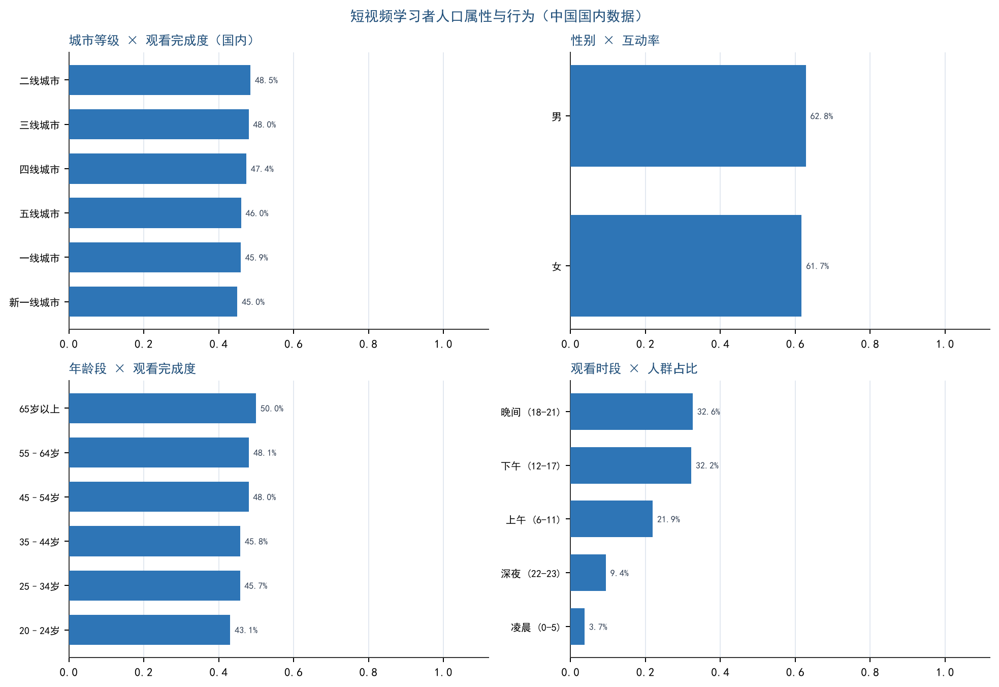

*图 11  短视频用户属性与行为（国内）*

#### 5.2.6  天池微课的学习终端与倍速、预习标签（国内数据）

天池脱敏微课样本提供倍速、设备、操作系统、网络与预习标签，使学习行为分析落到具体终端与时间投入方式。需要先修正一个口径陷阱：原始数据把非视频事件（测验、作业、论坛、下载、评价）的倍速统一记为 1.0×，而这些事件的进度增益本就接近零；若混算会制造“1.0× 进度最低”的虚假差异。因此倍速与预习的对照严格限定在 2,614 条视频播放事件内。

修正后各倍速档的进度增益彼此接近（0.75× 15.7 个百分点、1× 16.3 个百分点、1.25× 16.2 个百分点、1.5× 16.3 个百分点、1.75× 16.6 个百分点），Kruskal–Wallis 检验 H=1.823，p=0.768，差异不显著。这说明没有证据支持“倍速越高学习越多”，倍速更多反映个人观看习惯而非成效差异。课前预习与常规回看的进度增益分别为 16.84 与 16.09 个百分点，Mann–Whitney 检验 p=0.291，差异不显著。

**表 19  天池微课倍速与预习标签对照（视频事件内）**

| 标签 | 分组 | 事件数 | 占比 | 进度增益(点) | 交互次数 |
| --- | --- | --- | --- | --- | --- |
| 倍速 | 0.75× | 396 | 15.2% | 15.66 | 8.3 |
| 倍速 | 1× | 1,099 | 42.0% | 16.27 | 8.3 |
| 倍速 | 1.25× | 346 | 13.2% | 16.20 | 8.5 |
| 倍速 | 1.5× | 384 | 14.7% | 16.32 | 8.6 |
| 倍速 | 1.75× | 389 | 14.9% | 16.60 | 8.8 |
| 预习 | 课前预习 | 472 | 18.1% | 16.84 | 8.5 |
| 预习 | 常规回看 | 2,142 | 81.9% | 16.09 | 8.4 |

> 注：进度增益=观看后进度−观看前进度；仅视频事件可比。设备/OS/网络为全事件分布，见交互看板。

终端维度给出与“倍速无效”不同的另一类证据。全事件口径下，移动端、平板与 PC 的进度增益均在 9.4—9.6 个百分点之间，得分比与满意度也高度接近（得分比 0.715—0.727，满意度 3.89—3.92），说明设备形态本身不造成学习成效分化，移动端学习并不逊于 PC——这对以移动端为主的国内学习者具有直接意义。网络方面，WiFi 占 59.8%，各网络类型的得分比同样集中在 0.719—0.723。因此终端与网络宜作为体验保障项而非干预分层维度。

**表 20  天池微课的学习状态标签与得分对照**

| 状态标签 | 事件数 | 占比 | 进度增益(点) | 交互次数 | 得分比 |
| --- | --- | --- | --- | --- | --- |
| 无标签 | 4,299 | 86.0% | 10.83 | 10.0 | 0.765 |
| 及格边缘 | 402 | 8.0% | 1.73 | 21.4 | 0.639 |
| 待关注 | 162 | 3.2% | 1.79 | 21.3 | 0.468 |
| 学优表现 | 137 | 2.7% | 1.67 | 21.6 | 0.958 |

> 注：状态标签为数据集自带的过程性评价字段；仅“学优表现/及格边缘/待关注”三档有得分比，其得分比依次为高、中、低，与标签语义一致，可作为评价结果的外在效度佐证。

学习状态标签进一步提供外在效度检验：“学优表现”得分比 0.958 明显高于“待关注”的 0.468，与标签定义方向一致，说明状态标签并非随机赋予，具备基本的内容效度。同时应注意其事件数较少（三档合计约 14%），结论仅作方向性佐证，不用于个体判定。

*图 12  天池倍速、设备、预习与网络标签*

### 5.3  画像发现与干预含义

把两条证据链的画像结果放在一起，可以按“信号强度”分成三档，这是一个比“逐个维度都做干预”更可操作的结论。第一档是强信号且与行为可干预量直接相关：课程侧习惯分型与结果的关联最强（Cramér’s V=0.452），国内侧年龄与观看完成度的秩相关显著（H=48.324）。第二档是显著但效应弱：地区（V=0.078）、城市等级（完成度极差 3.5%）统计显著而实际区分度有限；城乡差异仅有描述性差距、未单独做显著性检验。第三档是不显著：性别（p=0.476）、倍速（p=0.768）、预习（p=0.291）均未检出可靠差异。分层依据的是效应量与显著性，而非维度是否‘看起来重要’。

由此得出的干预原则是：优先对第一档的可改变行为下手，第二档只用于内容分发与资源配置的细化，第三档不作为分层变量——这既避免把无效维度当成因，也符合最小必要与公平性要求。需要强调，以上均为观察性关联，国内短视频的 7 日窗口与 OULAD 的课程学期窗口口径不同，不合并推断。

群体比较还须注意平台效应：三平台认证基准率为 edX 2.9%、学堂在线 9.0%、Open University 47.7%，形态虚拟变量加入后 AUC 由 0.808 升至 0.908，似然比检验 χ²=1772.7（p<0.001），说明“形态”本身携带显著解释力，简单拼接数据训练单一模型会学到“平台指纹”并扭曲结论。因此第 7—8 章的评价与决策均在平台内、形态内口径下进行。

## 6  系统预测

### 6.1  早期预警时点识别

预警问题直接服务干预：目标是用观察窗口内累计行为与背景属性判断学习者最终能否通过，比较 2、4、6 周窗口的 5 折交叉验证 AUC，确定“最早可用”时点。样本 20,105 人，正例（Pass/Distinction）比例 49.4%；特征仅使用窗口内日志，标签为窗口之后的真实最终结果，不存在未来信息泄漏。

**表 21  预警窗口实测性能（5 折 CV）**

| 观察窗口 | AUC | F1 | 留出集 AUC | 留出集 F1 |
| --- | --- | --- | --- | --- |
| 第 2 周 | 0.7436 ± 0.0059 | 0.6687 | 0.7519 | 0.6697 |
| 第 4 周 | 0.7619 ± 0.0049 | 0.6863 | 0.7722 | 0.6916 |
| 第 6 周 | 0.7760 ± 0.0046 | 0.6969 | 0.7884 | 0.7065 |

> 注：窗口越晚信息越充分，AUC 单调递增；第 4 周 AUC=0.762，与第 6 周 0.776 相差 0.014，可提前两个周预警。

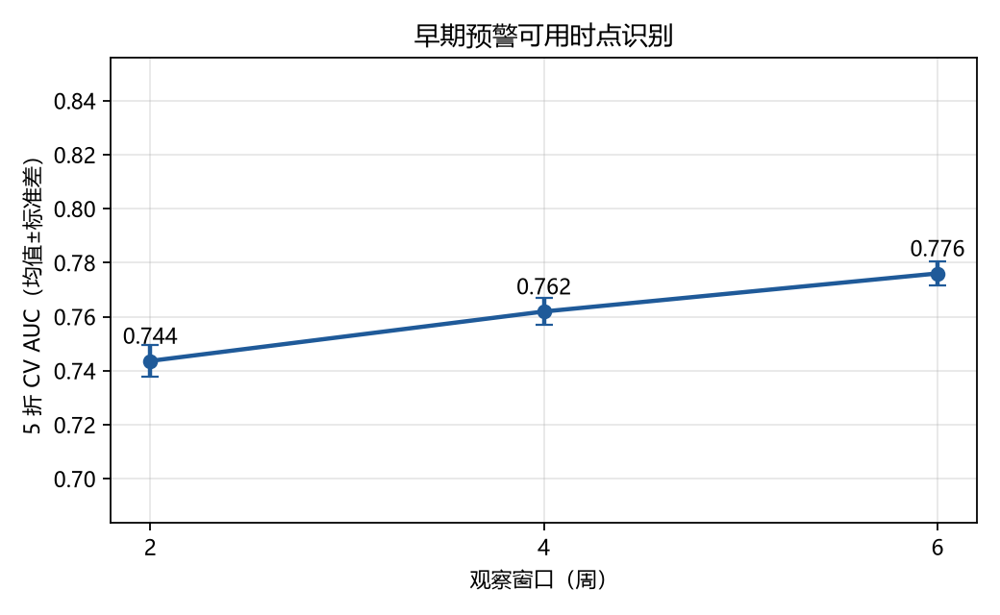

*图 13  2/4/6 周预警窗口的交叉验证 AUC*

据此把干预窗口前移至第 4 周：此时已获得足够行为证据，又留给教师与平台八周左右的干预时间。若坚持最早预警，第 2 周 AUC=0.744 仍高于随机水平，可作为低置信度的“关注名单”，但不宜据此做高强度资源投放。

> 补充：另以 Holt 二次指数平滑对周活跃序列作 4 周外推，测试 MAE=9.52、较朴素法下降 41.5%，可作为短期趋势参考；该结果与 GM(1,1) 对照见 forecast_results.json，不构成本文预测主线。

### 6.2  无泄漏通过预测与行为归因

第二个预测问题是判断学习者能否真实通过。在 20,105 条 OULAD 真实记录上训练逻辑回归、随机森林与梯度提升树，采用分层 5 折交叉验证与 25% 留出集，避免随机划分造成的类别比例漂移。最关键的科学性处理是无泄漏特征约束：标签 certificate 取自学期末真实结果，而 quiz_avg、final_grade、assign_rate 等与结果同期同生的测评字段一律禁止入模；入模特征仅含第 4 周之前的累计点击/活跃/论坛/资源覆盖等前期行为与年龄、既往重修次数等人口属性。前期行为与结果相关系数约 0.22—0.25，属合理可预测范围，避免了“用结果预测结果”的循环论证。

**表 22  三类预测模型性能（无泄漏口径）**

| 模型 | AUC | F1 | 准确率 | 交叉验证 AUC |
| --- | --- | --- | --- | --- |
| Logistic回归 | 0.8403 | 0.7497 | 0.7535 | 0.8280 |
| 随机森林 | 0.8451 | 0.7775 | 0.7643 | 0.8359 |
| 梯度提升树 | 0.8519 | 0.7859 | 0.7728 | 0.8395 |

> 注：留出集 5,027 条，真实正例率 49.4%；入模特征仅前期行为与人口属性，以 AUC/F1 为主，准确率仅作参考。

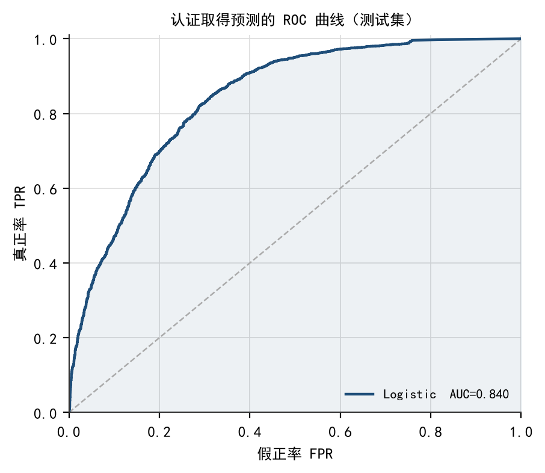

*图 14  三模型 ROC 曲线*

归因方面，逻辑回归优势比显示活跃天数是最强的正向关联变量（OR=8.628），随机森林特征重要性同样以活跃天数居首（0.291），访问次数与资源覆盖度次之。二者高度一致，说明“稳定的持续参与”而非突击行为构成真实达标的核心行为基础；且这些特征全部在第 4 周之前可观测，具备早期干预的可操作性。但相关系数不等于因果效应，干预结论仍需通过第 8 章的对照方案检验。

**表 23  关键行为归因（节选，无泄漏特征）**

| 来源 | 变量 | 数值 | 解释 |
| --- | --- | --- | --- |
| 逻辑回归优势比 | 活跃天数 | 8.628 | 标准化活跃天数每升 1 单位，真实通过优势约增至 8.63 倍 |
| 随机森林重要性 | 活跃天数 | 0.291 | 在非线性模型中贡献率最高 |
| 前2周点击 | early_w2_clicks | 1.329 | 正向关联 |
| 资源覆盖度 | video_rate | 1.293 | 正向关联 |
| 访问次数 | visit_count | 1.118 | 正向关联 |

> 注：优势比来自无泄漏 Logistic 模型；解释均限于关联，不作因果断言。作业提交率/测验均分因与结果同期同生已被排除。

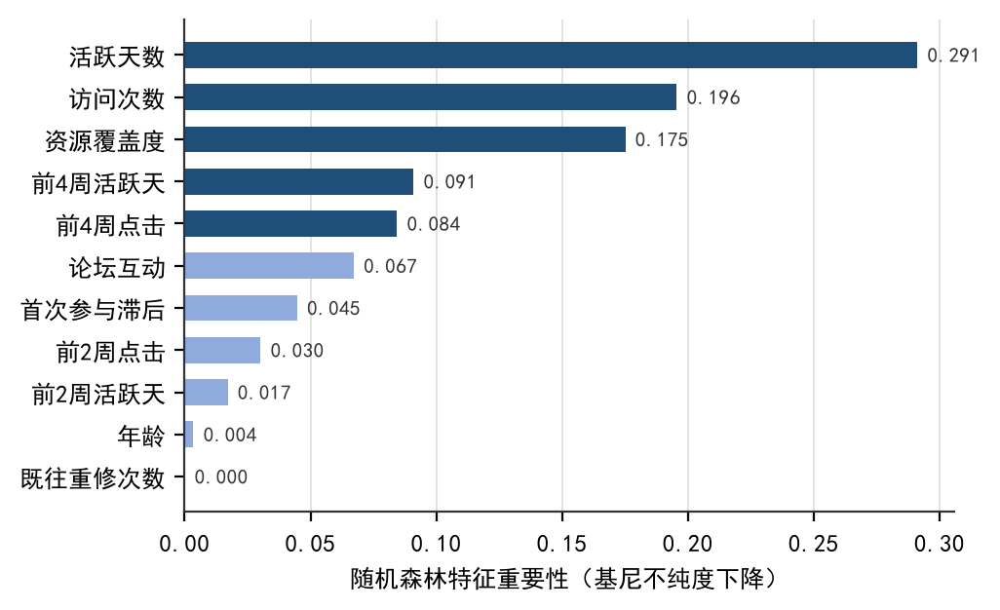

*图 15  随机森林特征重要性排序*

单一数据集上的高 AUC 可能是划分方式或样本构成的偶然结果，故在国内多形态数据上另做三层稳健性检验。第一层是重抽样置信区间：对 MOOC、微课、短视频各做 120 次 bootstrap，MOOC AUC 均值 0.940（95% 区间 0.935—0.945）、微课 AUC 均值 0.532（95% 区间 0.444—0.592）、短视频 AUC 均值 0.612（95% 区间 0.581—0.639）。区间宽度反映样本量差异——微课样本最小（723 条），区间也最宽，结论因此只作方向性使用。第二层是跨形态迁移：把在一种形态上训练的模型用于另一种形态，六组迁移的平均 AUC 为 0.657，低于域内平均 0.697，说明行为—成效的关联结构部分可迁移、但不能直接照搬。第三层是形态与平台效应：加入形态虚拟变量后 AUC 由 0.808 升至 0.908，似然比检验 χ²=1772.7（p<0.001）；三平台混合建模 AUC=0.941，反而低于平台内加权 0.958。两种情形都指向同一方法结论：多平台、多形态数据必须分层建模或显式引入形态项，简单拼接会让模型学到“平台指纹”而非学习规律。这也是本文坚持双证据链各自建模、不混算的直接依据。

## 7  系统评价

### 7.1  指标体系与组合赋权

指标体系遵循目标导向、可观测、可比较与最小必要四项原则，概念层为五维二十项：活跃度、投入度、交互度、坚持度、成效度各含四项观测指标。其中三项派生指标（学习节律熵、碎片化指数、路径偏移度）只用于画像解释，不进入综合评价，避免重复计数。

**表 24  五维二十项指标体系与实证收敛**

| 维度 | 概念层指标（4 项/维） | 实证层使用 | 收敛理由 |
| --- | --- | --- | --- |
| 活跃度 | 登录频率、访问次数、访问间隔、在线时长 | 访问次数、活跃天数 | 日志直接可得，其余维度共线 |
| 投入度 | 学习时长、单次时长、视频完成率、资源广度 | 学习时长、资源完成率 | 跨形态可标准化 |
| 交互度 | 发帖、回帖、提问、互动响应 | 论坛发帖数 | 部分形态无论坛字段 |
| 坚持度 | 活跃天数、连续周数、首次滞后、退出时点 | 首次参与滞后 | 保留可跨源对齐项 |
| 成效度 | 作业提交率、测验均分、认证状态、成绩提升 | 作业提交率、测验均分 | 标签语义按形态分别定义 |

> 注：实证层课程评价收敛为 6 项准则，跨形态群体评价收敛为 5 项绩效量；概念层用于目标界定，实证层用于赋权计算。

赋权采用主客观组合：AHP 体现课程目标与价值判断，熵权体现数据离散信息，组合权重 w=α·w_AHP+(1-α)·w_Entropy。AHP 判断矩阵依据第 4.1 节目标分解与领域判断确定，取 α=0.5 作为中性起点。

`CI = (λ_max - n)/(n-1),  CR = CI/RI`　　(2)

> 式中：当 CR<0.10 时判断矩阵一致性可接受；本例 n=6，RI=1.24。

**表 25  AHP、熵权与组合权重**

| 准则 | 含义 | AHP | 熵权 | 组合 α=0.5 |
| --- | --- | --- | --- | --- |
| C1 | 资源完成度 | 0.2698 | 0.1398 | 0.2048 |
| C2 | 学习投入 | 0.2698 | 0.1811 | 0.2254 |
| C3 | 互动参与 | 0.1485 | 0.2019 | 0.1752 |
| C4 | 成绩表现 | 0.1485 | 0.1166 | 0.1325 |
| C5 | 持续参与 | 0.0817 | 0.1441 | 0.1129 |
| C6 | 达标转化 | 0.0817 | 0.2166 | 0.1491 |

> 注：λ_max=6.0184，CI=0.0037，CR=0.003<0.10，一致性通过。α 由 0.5 提到 0.8 后权重向量改变，但排序第一的课程贴近度仅由 0.8194 变为 0.8079、排序不变（见 9.2 表 30 的 A、B 两组实跑），说明评价结论对赋权偏好不敏感。

### 7.2  模糊综合评价

学习行为等级边界本身模糊，采用梯形隶属函数把群体级五指标归一到 0—100 后映射到评语集 V={优, 良, 合格, 待改进}，分值向量 (95,80,65,50)。合成算子取加权平均型 M(·,+)，综合得分 S=B·Vᵀ，按分值区间定级；为避免双峰隶属度误判，另列主导隶属等级。跨形态评价采用五维准则，其 AHP 判断矩阵一致性比率 CR=0.00739<0.10，与课程层赋权分别检验，避免把两套权重口径混用。

**表 26  跨形态群体模糊综合评价**

| 评价单元 | 隶属度 B（优/良/合格/待改进） | 综合得分 | 得分等级 | 主导隶属等级 |
| --- | --- | --- | --- | --- |
| MOOC·Open University | 0.3746、0.2498、0.3401、0.0355 | 79.45 | 良 | 优 |
| MOOC·edX | 0.121、0.0、0.3、0.579 | 59.95 | 待改进 | 待改进 |
| MOOC·学堂在线 XuetangX | 0.4143、0.0、0.0、0.5857 | 68.64 | 合格 | 待改进 |
| 微课 | 0.3075、0.0、0.1267、0.5658 | 65.74 | 合格 | 待改进 |
| 短视频 | 0.0、0.1338、0.1444、0.7218 | 56.18 | 待改进 | 待改进 |
| 课堂对照 | 0.1356、0.0309、0.4972、0.3363 | 64.49 | 合格 | 合格 |

> 注：组合权重与 TOPSIS 排序的 Spearman ρ=0.9429，p=0.0048，两种方法高度一致。TOPSIS 课程层与跨形态层完整排序见 fuzzy_results.json 与 multimodal_results.json，正文以模糊评价为主。

结果表明 Open University 群体得分最高（79.45，良），短视频群体最低（56.18，待改进）；国内两个形态中，微课居中（65.74，合格），学堂在线与 edX 分别处于合格与待改进区间。这一排序与 TOPSIS 贴近度排序的等级系数为 0.943（p=0.005），说明结论不依赖单一合成算子。需要读出一个方法细节：部分单元的“综合得分等级”与“主导隶属等级”不一致（如 edX 得分 59.95 判待改进，学堂在线得分 68.64 判合格，但主导隶属均为待改进），这是模糊评价中双峰分布的光滑化结果——加权平均会把两端隶属度折成中间分，故本文并列报告主导等级，避免单一分值掩盖分布形态。最后须强调，该评价是同一五维标准化框架下的相对运营诊断，各形态标签语义不同（结业、测验通过、回访），不能把得分当作跨形态的绝对优劣。

## 8  系统决策与优化建议

### 8.1  0-1 整数规划模型

决策变量 x_j∈{0,1} 表示是否对第 j 个“细分单元 × 干预强度”组合投放资源。目标函数最大化预期有效学习者增量 Σ n_j·Δ_j·x_j；约束包括预算上限与同一细分单元至多选择一种强度。提升幅度 Δ_j 采用倒 U 型干预弹性：低投入群体边际收益随投入上升，高强度干预对已达标群体边际收益递减，避免人为设定使优化方案必然获胜。求解采用 scipy.optimize.milp，保证得到整数最优解而非贪心近似。

`max  Σ_j n_j Δ_j x_j    s.t.  Σ_j c_j n_j x_j ≤ B,  Σ_{j∈s} x_j ≤ 1,  x_j ∈ {0,1}`　　(3)

> 式中：n_j 为单元人数，Δ_j 为干预弹性给出的净提升率，c_j 为人均成本，B 为预算上限。

对照组设置：经验法按“通过率最低优先”投放，普惠法按人均等额覆盖全部单元。三者使用同一弹性函数与同一预算，只有分配规则不同，保证比较公平。需说明：提升幅度 Δ_j 与人均成本 c_j 来自运营经验设定，本文给出的增益是既定弹性假设下的相对比较，用于比较分配规则的优劣，而非可直接兑现的绝对收益，实际投放前需用 A/B 测试校准参数。

### 8.2  求解结果与三方案对照

**表 27  OULAD 真实主线三方案对照（预算按 45% 测算）**

| 方案 | 预期有效人数 | 投入成本（元） | 特征 |
| --- | --- | --- | --- |
| 0-1 规划最优 | 1125.6 | 415,340 | 预算内整数最优 |
| 经验法 | 704.8 | — | 低通过率优先 |
| 普惠法 | 553.5 | — | 人均等额覆盖 |

> 注：基于 20,105 条 OULAD 真实记录；预算 416,826 元；最优方案相对经验法提升 59.7%，相对普惠法提升 103.4%。

**表 28  真实多形态数据三方案对照**

| 方案 | 预期有效人数 | 投入成本（元） | 说明 |
| --- | --- | --- | --- |
| 0-1 规划最优 | 1400.5 | 198,201 | 选中 9 个“形态×画像×强度”组合 |
| 经验法 | 502.0 | — | 高基础率单元优先 |
| 普惠法 | 754.5 | — | 全部在线单元普惠投放 |

> 注：预算 199,184 元；课堂对照 1,044 人不参与线上干预预算；最优相对经验法与普惠法分别提升 179.0% 与 85.6%。

两层决策的结论方向一致：优化分配显著优于经验法与普惠法。差异在于真实数据层的可分人群更多、干预单元更细，最优组合由 3 个扩展到 9 个；这说明画像颗粒度越贴合业务，优化空间越大。值得注意的是，多形态层选中的 9 个组合中有 6 个来自国内短视频与微课形态，覆盖 2,192 人、约占最优覆盖人数的 39%——组合数占多数而覆盖人数占比略低，是因为国内形态的细分单元规模较小、切分更细。这说明国内数据不只是画像补充，而是以更精细的颗粒度直接参与资源分配。两层预算、两套标签各自独立测算，增益不可相加，仅用于比较各自分配规则的优劣。

> 预算灵敏度：把预算比例从 20% 扫描到 100% 的 8 档实跑显示，最优方案始终不低于对照方案，中等预算区间（40%—60%）相对优势最明显，预算接近全覆盖时三者差距收敛；完整曲线见 results.json/sweep 与离线看板，正文不再展开。

### 8.3  跨形态干预组合决策

真实数据层把 8,192 名在线学习者按“形态 × 画像簇”划分为 12 个细分单元，每个单元配置基础包与强化包两种强度，共 24 个候选；同一单元至多选一种强度。最优解选中 9 个组合，覆盖 MOOC、微课与短视频三类形态。课堂对照作为零在线端点被显式排除，避免把无法投放的对象纳入预算分母。

**表 29  最优干预组合（真实数据层，节选）**

| 细分单元 | 强度 | 覆盖人数 | 成本（元） | 预期增益 |
| --- | --- | --- | --- | --- |
| MOOC-C2 | 强化包 | 1,640 | 47,893 | 577.6 |
| MOOC-C4 | 强化包 | 1,599 | 69,936 | 267.3 |
| MOOC-C6 | 强化包 | 154 | 6,022 | 43.4 |
| 微课-C1 | 强化包 | 412 | 8,081 | 80.3 |
| 微课-C2 | 强化包 | 311 | 6,537 | 72.1 |
| 短视频-C1 | 强化包 | 391 | 14,773 | 119.1 |
| 短视频-C3 | 强化包 | 521 | 21,793 | 114.9 |
| 短视频-C2 | 强化包 | 482 | 20,155 | 106.5 |
| 短视频-C4 | 强化包 | 75 | 3,011 | 19.5 |

*图 16  跨形态评价排序与干预预算决策结果*

方案的可解释性来自“倒 U 型弹性”：对高基础率群体，强化包边际收益递减，最优解倾向基础包；对低基础率但行为可塑的群体，强化包带来更高净增益。这一机制使优化结果能被教师逐条解释，而不是一个不可追溯的黑箱分配。

### 8.4  分层优化建议与实施闭环

面向平台，依据 ISM 的中间层杠杆，优先优化资源质量、学习支持与交互工具，而不是把预算投向难以改变的先备知识差异；面向教师，依据第 4 周预警名单与四类画像，对低投入游离型提供结构化任务清单，对社交深耕型开放协作任务，对自主达标型减少打扰；面向学习者，提供可自查的行为反馈与目标设定提示。

**表 30  三类对象的分层干预建议**

| 对象 | 触发证据 | 建议措施 | 回置指标 |
| --- | --- | --- | --- |
| 平台运营 | 形态效应 χ²=1772.7；平台指纹检验 | 分形态建模、平台内标准化、按单元投放 | AUC 差异、PSA/KS 偏移 |
| 教师/助教 | 第 4 周预警 AUC=0.762；四类画像 | 分层任务清单与第 4 周干预窗口 | 作业提交率、资源完成率 |
| 学习者 | 低投入游离型占比与首次滞后 | 目标提示、节律建议、轻量化资源包 | 活跃天数、学习时长 |

实施闭环与副作用检验：系统动力学视角提示三类反馈——R1 成效—动机增强回路（成效提升→自我效能上升→投入增加→成效再升）、B1 时间约束回路（投入增加→可支配时间减少→压力上升→单次质量与持续性下降）、B2 难度—挫败回路（内容难度相对能力过高→测验失败→挫败累积→动机下降）。因此“提高提醒频次”虽可能短期提升活跃，却会经 B1 抬高长期流失风险；建议把提醒与任务减负打包投放，并用第 4 周预警与第 8 周复评检验净效应。措施执行后重新计算五维指标与评价等级、比较干预前后变化，即构成“评价—决策—实施—再评价”的一轮闭环；本轮结果还可回置到 ISM 邻接矩阵与 AHP 判断矩阵，用于下一轮校正，但这一步需在真实干预数据回收后进行。

## 9  可验证成果与结论

### 9.1  交互程序与模型—代码对照

交付的可验证成果是一个可交互、可改参、可重跑的行为分析程序（app.py），提供网页界面、命令行交互与批跑三种模式。网页界面支持上传真实 CSV（需含与 OULAD 主表兼容的字段）、切换“内置 OULAD 真实数据/现场上传”数据源、调整 K、预算比例、AHP 组合系数 α、测试集比例与随机种子；每次运行写入参数快照 results_latest.json，并在界面展示改前—改后的关键数字。程序内置线程锁，避免并发请求造成结果串台。程序不含任何仿真数据生成器，默认数据源与内置样本均为真实公开数据。

**表 31  可验证程序功能清单**

| 功能 | 入口 | 可改参数 | 输出 |
| --- | --- | --- | --- |
| 数据接入 | 上传真实 CSV / OULAD 内置 | 数据源 | 校验报告、清洗日志 |
| 画像重跑 | analysis.cluster | K、seed | 画像表、轮廓系数、结构占比 |
| 预测重跑 | analysis.predict / forecast | test_size、seed | 无泄漏 AUC/F1、预测曲线 |
| 评价重跑 | analysis.evaluate / fuzzy_eval | α、自定义权重 | 权重、排序、等级 |
| 决策重跑 | analysis.decide | budget_ratio | 最优组合、三方案对照 |
| 看板刷新 | build_dashboard.py | — | 单文件离线 dashboard.html |

> 注：所有参数均记录在 run_pipeline 的 meta.params 中，可逐次回溯；数据来源字段标明为 OULAD 真实数据。

为保证方法描述与程序实现一致，建立逐条对照表（完整版见 06_支撑文档/模型—代码对照表.md）。随机抽查任一公式，均可在代码中定位并在结果 JSON 中找到对应数字。

**表 32  核心模型—代码—结果对照**

| 报告内容 | 代码位置 | 结果文件 | 可核对数字 |
| --- | --- | --- | --- |
| ISM 可达矩阵 | analysis.ism() | results.json/ism | 五级递阶、MICMAC |
| K 值扫描与画像 | analysis.cluster() | results.json/cluster | k=4，轮廓 0.368 |
| 无泄漏预测 | analysis.predict() | results.json/predict | AUC=0.8403（前期特征） |
| AHP 一致性 | analysis.ahp() | results.json/evaluate | CR=0.003（课程层） |
| 组合赋权 | app.run_pipeline() | results.json/evaluate | α=0.5，6 项权重 |
| 0-1 规划 | analysis.decide() | results.json/decide | 1125.6 人 / 1400.5 人 |
| 早期预警 | forecast.py | forecast_results.json | 第 4 周 AUC=0.762 |
| 模糊综合评价 | fuzzy_eval.py | fuzzy_results.json | ρ=0.943 |
| 形态/平台效应 | multimodal.py | multimodal_results.json | χ²=1772.7 |
| 六维画像 | profile_modeling.py | profile_results.json | 地区 V=0.078；倍速 p=0.768 |

> 注：模型代码集中在 03_源代码/，运行结果为 04_运行结果/ 下的 JSON；报告生成脚本不内嵌任何硬编码结果。

### 9.2  改参重跑与复现

为检验参数敏感性，预先跑出“改前—改后”数字。三组分别验证：改变评价偏好（α）、改变画像粒度（K）与预算上限。所有结果由 demo_runs.py 调用同一 run_pipeline 产生，留痕在 04_运行结果/demo_runs/。

**表 33  三组改参重跑前后对照**

| 场景 | 参数变更 | 轮廓/ARI | 评价第一（贴近度） | 最优/经验收益 |
| --- | --- | --- | --- | --- |
| A_基准 | α=0.5, k=4, 预算比例=45% | 轮廓 0.368 / ARI —（真实数据无预设真值） | AAA2013J (0.8194) | 1125.6 / 704.8 |
| B_改权重 | α=0.8, k=4, 预算比例=45% | 轮廓 0.368 / ARI —（真实数据无预设真值） | AAA2013J (0.8079) | 1125.6 / 704.8 |
| C_改K与预算 | α=0.5, k=3, 预算比例=60% | 轮廓 0.475 / ARI —（真实数据无预设真值） | AAA2013J (0.8194) | 1687.8 / 939.7 |

> 注：A 为基准；B 仅改 α，权重向量变化但排序不变；C 改 K 与预算，画像数与轮廓系数变化，最优收益仍稳健。真实数据无潜在类别真值，ARI 记为不可计算。

运行环境为 Python 3.10 及以上（推荐 3.11—3.12），依赖见 03_源代码/requirements.txt。全部结果可由交付包根目录的一条命令复现：python 03_源代码/run_all.py。该入口按依赖顺序串联数据派生、多形态测评、主线流水线、早期预警、模糊评价、六维画像、改参快照、图表与看板、报告生成等步骤，并支持 --check（体检）、--web（起交互平台）、--from-raw（含 OULAD 原始派生）等选项；分步命令、参数说明与上传字段格式见 06_支撑文档/运行说明.md。

固定种子 20260101 写在 analysis.py 与 forecast.py 中，也可通过界面或 --seed 覆盖；每次重跑都会在 results_latest.json 中保留本次参数与耗时，便于核对不同参数下的结果差异。

### 9.3  主要结论与展望

第一，在数据基础层面，本文以两条并重的真实证据链展开，全部为公开数据、不含仿真样本。课程级证据为 OULAD 派生的 20,105 条记录（18,634 人、13 门课），带真实结业标签，回答“课程能否通过”；国内场景与内容级证据以清华 FIB 短视频的 6,654 名用户（365 座城市）和天池微课为主体，含小时级时段、内容类别、城乡与终端标签，与 edX、学堂在线等对齐后共 9,236 条多形态样本，回答“什么内容被持续观看”。两条链各有不可替代的信息，分层呈现、不混算；字段口径与缺失处理写入附录 A。

第二，在分析与预测评价层面，以霍尔逻辑维七步为骨架、CATWOE 完成软问题界定，得出一条按证据强度分层的结论：习惯分型（V=0.452）与国内年龄梯度（H=48.324，p<0.001）是强信号，地区（V=0.078）、城市等级（极差 3.5%）显著但效应弱，性别（p=0.476）、倍速（p=0.768）、预习（p=0.291）在排除结构性伪影后不显著——这决定了干预只针对可改变行为。预测环节第 4 周即可有效预警（AUC=0.762），无泄漏通过预测 AUC=0.8403；国内多形态数据的 bootstrap 区间、跨域迁移与形态/平台效应检验进一步证明必须分层建模：加入形态项 AUC 由 0.808 升至 0.908。评价环节以 CR=0.0074 的跨形态 AHP 矩阵、组合赋权与模糊综合评价交叉验证，两种合成算子排序一致（ρ=0.943）。

第三，在决策与优化层面，把评价结论输入 0-1 整数规划：课程层最优组合较经验法提升 59.7%；多形态层在 199,184 元预算下得到 9 个组合、惠及 1,400.5 人，较经验法与普惠法分别提升 179.0% 与 85.6%，其中多数组合来自国内短视频与微课形态，国内数据直接决定资源投向。两层增益均为既定弹性假设下的相对比较，不可相加。配套的可验证程序支持上传数据、改参重跑与前后对比，三组实跑与预算扫描证明结论对赋权偏好、K 粒度与预算水平稳健。

局限有三。其一，相关不等于因果：ISM 与 AHP 依赖领域判断，预测模型识别的是关联结构；干预弹性虽采用倒 U 型设定并做对照，仍需准实验进一步识别因果效应。其二，数据窗口有限：清华短视频数据仅 7 天采样，标签为“后 2 日回访”而非完课率，不宜外推到长期学习成效；OULAD 的等效学习时长与资源覆盖度为点击折算代理，不等于真实计时或完播。其三，伦理边界：个体预警只用于支持性干预，不用于评价排名；短视频采集口径与平台条款需持续核验。后续工作将把第 4 周预警嵌入平台 A/B 测试，按实际干预结果回置 ISM 邻接矩阵与 AHP 判断矩阵，并补充跨学期数据以检验长期稳定性。

## 参考文献

[1] HALL A D. A methodology for systems engineering[M]. Princeton: Van Nostrand, 1962.

[2] CHECKLAND P. Systems thinking, systems practice[M]. Chichester: John Wiley & Sons, 1981.

[3] WARFIELD J N. Developing interconnection matrices in structural modeling[J]. IEEE Transactions on Systems, Man, and Cybernetics, 1974, SMC-4(1): 81-87.

[4] SAATY T L. The analytic hierarchy process[M]. New York: McGraw-Hill, 1980.

[5] ZADEH L A. Fuzzy sets[J]. Information and Control, 1965, 8(3): 338-353.

[6] 汪应洛. 系统工程[M]. 5 版. 北京: 机械工业出版社, 2015.

[7] 郭亚军. 综合评价理论与方法[M]. 北京: 科学出版社, 2002.

[8] 汪培庄. 模糊集合论及其应用[M]. 上海: 上海科学技术出版社, 1983.

[9] KIZILCEC R F, PIECH C, SCHNEIDER E. Deconstructing disengagement: analyzing learner subpopulations in massive open online courses[C]//Proceedings of the 3rd International Conference on Learning Analytics and Knowledge. Leuven: ACM, 2013: 170-179.

[10] REICH J, RUIPÉREZ-VALIENTE J A. The MOOC pivot[J]. Science, 2019, 363(6423): 130-131.

[11] KUZILEK J, HLOSTA M, ZDRAHAL Z. Open University Learning Analytics dataset[J]. Scientific Data, 2017, 4: 170171.

[12] 清华大学 FIB 实验室. WWW 2025 移动短视频行为、属性与内容公开数据集[DB/OL]. http://fi.ee.tsinghua.edu.cn/datasets/short-video-dataset, 2025.

[13] 阿里云天池. 中国高校慕课课程多维画像与学习行为脱敏样本数据集（2024—2025）[DB/OL]. https://tianchi.aliyun.com, 2025.

## 附录 A  数据说明

A.1 两条并重的真实证据链（全文无仿真）。课程级证据：build_real_learners.py 从 OULAD 五张原始公开表派生的 20,105 条真实记录（18,634 人、13 门课，2013J/2014J 学期），含人口属性、前期行为、测评得分与真实 final_result，派生口径见 real_learners_meta.json。国内场景与内容级证据：清华 FIB 短视频数据集 6,654 名用户的属性画像（794,053 条观看事件、365 座城市）与天池微课样本（5,000 事件、715 名学习者）的终端与预习标签；用于预测与决策的多形态对齐样本为 9,236 条（MOOC 6,000 / 微课 723 / 短视频 1,469 / 课堂对照 1,044）。两条链分章呈现、不混算；不同分析环节的同源数据口径差异见 3.2。随机种子 20260101 仅用于算法可复现，不生成数据。

A.2 来源与授权。edX/HMXPC13、OULAD、KDD Cup 2015 学堂在线、阿里云天池高校慕课样本、清华 FIB WWW 2025 短视频数据集、UCI #320 Student Performance。来源清单、下载日期与预处理脚本见 02_数据与数据集/sources.json 与 06_支撑文档/多形态数据说明.md。

A.3 字段字典。核心字段与口径见 02_数据与数据集/字段字典.csv、字段对齐表.csv；五维共享指标 engage/persist/complete/interact/context 均在形态内标准化，跨形态比较只使用标准化值。

A.4 合规。所有数据脱敏、无登录凭据落盘；原始大体量日志（OULAD studentVle 约 433MB）不随包分发，派生脚本 build_real_learners.py 与 build_forecast_data.py 可由公开源复现主表与预测小表；交付的 real_learners.csv、weekly_activity.csv、early_warning.csv 均为派生后的真实聚合数据。个体结果仅限支持性干预。

A.5 补充材料。字段对齐表、数据源清单、方法适配矩阵见 02_数据与数据集/；数据说明与多形态数据说明见 06_支撑文档/。

## 附录 B  生成式 AI 使用声明表

**生成式 AI 使用范围与核验**

| 使用环节 | 使用方式 | 人工核验责任 | 状态 |
| --- | --- | --- | --- |
| 文献与资料检索 | 辅助检索公开数据源与方法出处 | 组员逐条核对原文与链接 | 已核验 |
| 文字润色与格式 | 辅助语句通顺化、图表排版 | 组员逐段复核并定稿 | 已核验 |
| 代码辅助 | 辅助脚本编写、报错定位 | 组员运行验证并解释每行逻辑 | 已核验 |
| 数据下载与清洗 | 辅助下载脚本与字段对齐 | 组员核对样本量与缺失率 | 已核验 |
| 问题界定/方法选择 | 不使用 AI 代做 | 由组员依据课程理论独立确定 | 组员完成 |
| 指标与权重设计 | 不使用 AI 代做 | AHP/ISM 判断矩阵由组员共同判定 | 组员完成 |
| 评价与决策结论 | 不使用 AI 代做 | 由组员解释并承担学术责任 | 组员完成 |

> 注：AI 输出仅作辅助，最终学术责任由全体组员承担；签名与日期由组员填写。

组员签名：＿＿＿＿＿＿＿＿　　日期：＿＿＿＿年＿＿月＿＿日

## 附录 C  代码清单

**表 34  交付代码清单**

| 文件（03_源代码/ 与 05_图表与看板/） | 职责 |
| --- | --- |
| build_real_learners.py | 从 OULAD 原始表派生真实学习者主表 |
| analysis.py | 清洗、画像、无泄漏预测、评价、0-1 规划、ISM |
| multimodal.py | 六源多形态对齐、分布偏移、迁移与决策 |
| forecast.py | 早期预警、序列特征识别、指数平滑与 GM(1,1) |
| fuzzy_eval.py | 模糊综合评价与 TOPSIS 一致性检验 |
| build_profile_inputs.py | 从真实原始数据派生短视频用户表与天池标签表 |
| profile_modeling.py | 六维画像与差异检验（地区/背景/习惯/兴趣/短视频属性/天池标签） |
| figures.py / multimodal_figures.py | 系统边界、技术路线、ISM、画像、评价与决策绘图 |
| build_forecast_data.py | 从 OULAD 派生预测用周序列与预警面板 |
| app.py | Web/CLI/批跑交互验证平台 |
| demo_runs.py | 三组改参重跑与差异留痕 |
| build_final_report.py | 由实跑 JSON 生成报告 docx/md |
| build_dashboard.py | 生成单文件离线看板 |
| build_persona_dashboard.py | 生成形态切换与用户画像交互看板 |

> 注：完整运行顺序见 9.2 节；requirements.txt 在 03_源代码/ 下。

## 附录 D  组员工作量与贡献度说明

**组员分工与贡献度**

| 姓名 | 学号 | 负责模块 | 贡献度 | 签名 |
| --- | --- | --- | --- | --- |
| （待填） | （待填） | 问题界定、CATWOE、ISM 判断矩阵 | （待填） |  |
| （待填） | （待填） | 数据收集对齐、清洗与质量评价 | （待填） |  |
| （待填） | （待填） | 画像建模、预测与评价、代码核验 | （待填） |  |
| （待填） | （待填） | 决策优化、可验证程序与报告统稿 | （待填） |  |

> 注：贡献度之和应为 100%；AHP 与 ISM 判断由组员独立完成并可追溯解释。

