# 《系统工程原理》实践项目研究报告 — 选题 7

## 目　录

- 摘  要
- 1  问题界定
  - 1.1  研究背景与问题提出
  - 1.2  系统边界、要素与 CATWOE 根定义
  - 1.3  研究主线与章节安排
- 2  方法论与总体框架
  - 2.1  方法论选择：软起步、硬落地
  - 2.2  霍尔逻辑维七步的贯穿映射
  - 2.3  方法体系与技术路线
- 3  支撑数据与分析对象
  - 3.1  数据总体策略：六源统一口径
  - 3.2  六源真实数据构成
  - 3.3  统一 schema 与字段对齐
  - 3.4  样本结构与描述统计
  - 3.5  数据伦理与最小必要原则
- 4  系统建模
  - 4.1  目标体系与功能分解
  - 4.2  解释结构模型（ISM）
- 5  系统分析
  - 5.1  统一聚类画像：K-means 与四类原型
  - 5.2  行为序列与资源挖掘
  - 5.3  相关结构与投入分层
  - 5.4  多形态扩展验证
  - 5.5  内容级画像（国内数据）
- 6  系统预测
  - 6.1  无泄漏预测与早期预警
  - 6.2  行为归因与灰度趋势
- 7  系统评价
  - 7.1  指标体系与 AHP 组合赋权
  - 7.2  模糊综合评价
  - 7.3  系统动力学（SD）策略仿真
- 8  系统决策与优化建议
  - 8.1  分层干预队列
  - 8.2  多形态预算 0-1 规划
  - 8.3  优化建议与实施闭环
- 9  可验证成果与结论
  - 9.1  复现方式与模型—代码对照
  - 9.2  主要结论
  - 9.3  局限与展望
- 参考文献
- 附录 A  数据说明
- 附录 B  生成式 AI 使用声明表
- 附录 C  代码清单
- 附录 D  组员工作量与贡献度说明

## 摘  要

慕课、微课与短视频改变了学习模式，访问与观看日志既记录显性行为，也折射兴趣与习惯。如何从异构数据识别画像、发现规律并转化为平台可执行的改进措施，是本文要回答的问题。

本文以系统工程方法论为主线，按“数据融合—建模—分析—预测—评价—决策”构建框架，以霍尔逻辑维七步组织各环节、CATWOE 界定边界。全部分析建立在六类真实公开数据集的统一合并总表之上：HarvardX/MITx 慕课、清华 FIB 短视频、ASSISTments 编程练习、英国开放大学 OULAD、UCI 课堂对照与天池高校慕课，合计 66,644 名学习者，不单独拆分任何一个数据集；另以 9,236 条四形态对齐样本（慕课 6,000 / 微课 723 / 短视频 1,469 / 课堂对照 1,044）检验方法跨场景稳健性，并以国内内容级画像补充“学习者是谁”的证据。

结果表明：六源合并后统一聚类收敛于四类画像（轮廓系数 0.552，GPU 加速），风险流失型占 79.9%；投入分层最高组较最低组完成率提升 50.0%、成绩提升 23.7 分；仅用早期 4 周行为即可实现有效区分（AUC=0.882），全量特征区分度 AUC=0.978、达标判断准确率 95.5%；AHP+模糊综合评价（一致性比率 CR=0.016）显示学习者质量分层均值仅 45.5 分，优化空间集中在低投入群体；52 周系统动力学仿真表明“加强资源供给”策略远优于短期激励。多形态验证发现跨场景分布显著偏移（PSI 0.95—5.85），方法可迁移但必须分形态校准；加入形态项后 AUC 由 0.808 升至 0.908，证明跨平台数据不可简单拼接。

据此提出以可干预行为为抓手、按画像分层帮扶、以资源供给为长期根本、实施后再评价的建议。

关键词：线上学习行为；系统工程；学习者画像；无泄漏预测；干预优化

## 1  问题界定

### 1.1  研究背景与问题提出

慕课、微课与短视频的普及，使学习行为的发生场景从固定物理课堂迁移到时间与空间可自由分割的数字环境。这一迁移带来两个直接后果：其一，行为颗粒度显著细化，一次登录、一段观看、一次暂停、一道测验作答都可被记录为带时间戳的事件；其二，学习者异质性被充分暴露，同一门课程的学习者可能分布在不同地区、处于不同教育阶段、拥有完全不同的时间预算与设备条件。

登录时间、选课数量与类别、学习时长等数据，既记录了学习者的显性行为，也留下兴趣、习惯与背景的线索。把这些线索组织起来，可以在不掌握个体身份的情况下描述其画像与行为规律；再比较不同群体学习者之间的差异，就能把群体分得更细，让教师与平台的措施更有针对性。据此，本文把研究问题界定为三个相互关联的子问题：跨形态、跨平台异构数据如何对齐为可比较的分析对象；如何从行为数据中辨识画像、识别影响因素并作预测与评价；如何把评价结论转化为有预算约束、可解释、可复验的干预决策。

现有研究多沿“数据—算法—结论”的直线路径推进，存在三点不足：分析对象缺乏系统界定，样本常取自单一平台；指标选取服从数据可得性而非目标导向，导致高相关特征被误读为成因；模型结论与管理决策之间缺少回路，预测准确率止步于模型报告。本文以系统工程方法论回应上述不足，并把方法使用限制在每一环节的合理性论证之内。

### 1.2  系统边界、要素与 CATWOE 根定义

研究对象不是线上学习平台本身，而是“学习者—资源—平台—环境”相互作用形成的行为系统。系统输入为教育背景、性别、地域类型等背景属性与平台日志；转换过程为选课、访问、观看、测验、交互等行为的累积；系统输出为画像类别、成效代理与干预建议；环境约束包括数据隐私规范、网络条件与学习者时间预算。

**表 1  CATWOE 根定义六要素**

| 要素 | 本文对应内容 | 对建模的约束 |
| --- | --- | --- |
| C 客户 | 学习者、教师、平台运营方、用人机构 | 目标多元，不能只用完成率单一指标 |
| A 行动者 | 教师、助教、平台运营与算法推荐机制 | 干预手段必须落在行动者可控范围 |
| T 转换过程 | 潜在学习者 → 持续参与并达成目标的学习者 | 以行为序列而非一次性快照刻画 |
| W 世界观 | 优质教育资源应突破地域与时空限制 | 关注群体差异，避免平均化 |
| O 所有者 | 平台运营方与课程提供方 | 数据使用需授权，结论服务运营改进 |
| E 环境约束 | 隐私规范、网络条件、时间预算、设备条件 | 最小必要采集，脱敏后建模 |

> 注：根定义决定“软起步、硬落地”的两段式处理：问题界定承认目标多元，建模阶段在边界内使用定量工具。

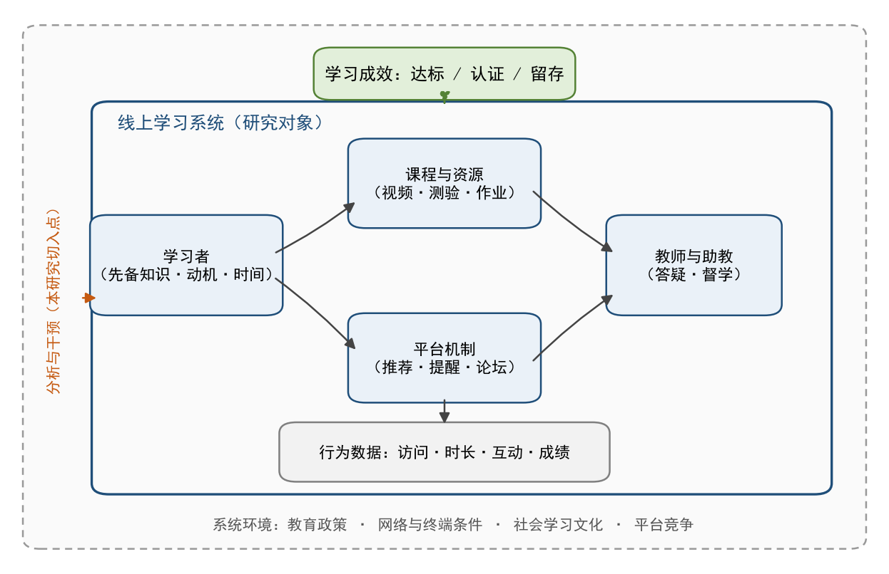

*图 1  学习者行为系统边界与输入输出*

基于根定义可导出三层次目标：平台层追求规模与留存的可持续，表现为活跃比例、完成率与续选率；教师层追求教学有效性与干预及时性，表现为投入水平、掌握增益与困难识别前置性；学习者层追求学习收益与时间成本的匹配，表现为目标达成度与体验满意度。三层目标存在冲突：提高提醒频次可能短期提升活跃，却加剧时间压力并抬高长期流失风险，因此需把弱冲突转化为约束条件，而非简单提高活跃目标权重。

### 1.3  研究主线与章节安排

全文按“数据融合—系统建模—系统分析—系统预测—系统评价—决策优化”展开，每一类系统工程方法单独成章，章节安排如下。

- 第 1—2 章界定问题并建立方法框架，以霍尔逻辑维七步作为唯一骨架，说明每一步为何选用相应方法。
- 第 3 章交代六类真实数据集的统一合并口径（66,644 名学习者）与统一 schema 适配方案。
- 第 4 章为系统建模：先分解目标体系与功能模块，再用 ISM 把八项影响因素整理成可计算的递阶结构。
- 第 5 章为系统分析：统一管线上以 K-means 形成四类行为画像并做序列/关联挖掘；多形态扩展检验方法跨场景稳健性；内容级画像从时段、兴趣、人口属性与平台标签刻画国内学习者。
- 第 6 章为系统预测：无泄漏达标预测、第 4 周早期预警与灰度趋势刻画行为—成效关联。
- 第 7 章为系统评价：以 AHP—模糊综合评价形成可解释的质量分层，并以 SD 仿真检验长期策略。
- 第 8 章为系统决策与优化：分层干预队列、多形态预算 0-1 规划与分层优化建议。
- 第 9 章给出复现方式与模型—代码对照，总结主要结论与局限。

## 2  方法论与总体框架

### 2.1  方法论选择：软起步、硬落地

霍尔三维结构把系统工程活动分解为时间维、逻辑维与知识维：逻辑维描述解决一个问题所经历的思维步骤，具有跨领域普适性。切克兰德指出，当系统涉及人的目标、价值判断与认知差异时，“寻求最优解”的硬系统假设往往不成立，应以“学习与比较”代替“优化”。线上学习行为系统同时具备两类特征：一方面，登录、观看、测验等日志是可观测、可量化的硬数据；另一方面，“学习目标达成”“教学质量”“有意义的交互”等概念本身多元且存在价值判断，属于软问题。

因此本文采取两段式处理：问题界定阶段使用软系统方法，承认目标多元，通过利益相关者分析与 CATWOE 构建各方可接受的根定义；建模、评价与决策阶段转入硬系统方法，在根定义划定的边界内使用 ISM、无泄漏预测、组合赋权与 0-1 规划等定量工具。WSR（物理—事理—人理）所强调的“是什么—怎么做—应当怎样”已分别落入数据、模型与目标三层，不再单列映射。这一分工避免两种常见偏差：纯粹软方法使研究停留在概念图层面，缺乏可检验结论；纯粹硬方法使模型精致但问题错位，把可计算的指标误当作真正的目标。

### 2.2  霍尔逻辑维七步的贯穿映射

霍尔逻辑维包含七个步骤。本文把七步逐一落到章节、方法与输出，形成可核对的主线（表 2），使研究链条闭合。

**表 2  霍尔逻辑维七步 ↔ 章节 ↔ 方法 ↔ 输出**

| 逻辑维步骤 | 落点章节 | 使用方法 | 主要输出 |
| --- | --- | --- | --- |
| ①明确问题 | 1.1—1.2 | 现状说明、系统边界、CATWOE | 系统边界图、根定义表 |
| ②选择目标 | 4.1 | 目标树、冲突协调（弱冲突转约束） | 三层目标体系 |
| ③系统综合 | 4.2、8.2 | ISM 递阶、多方案生成：画像簇 × 干预强度 | 递阶结构、四类画像、干预候选单元 |
| ④系统分析 | 第 3、5 章 | 数据融合、聚类画像、序列/关联挖掘 | 画像表、挖掘与分层结论 |
| ⑤方案优化 | 第 6—8 章 | 无泄漏预测 + AHP 模糊评价 + 0-1 规划 | 最优组合与三方案对照 |
| ⑥作出决策 | 8.1、8.3 | 分层干预队列、实施闭环 | 分层建议与优化清单 |
| ⑦付诸实施 | 第 9 章 | 一键复现、看板验证、再评价 | 可复现结果、复现记录 |

> 注：七步不是线性流水线：第 7 步的再评价用于检验前六步的结论，并为回置到第 4.2 节 ISM 邻接矩阵与第 7.1 节 AHP 判断矩阵提供条件。本报告完成的是可复现的离线验证，实际回置须在平台 A/B 测试取得干预结果后执行，详见 9.3 展望。

*图 2  整体技术路线：七步主线与六源统一口径*

### 2.3  方法体系与技术路线

围绕上述主线，本文保留五类直接服务于研究目标的方法，各自单独成章：系统建模把目标与因素关系转成可计算结构，系统分析用于画像与群体差异识别，系统预测用于判断“能否干预、何时干预”，系统评价给出可比较的运营诊断，系统决策用于形成有预算约束的资源配置方案。各类方法均有实跑证据（表 3）。

**表 3  方法体系与实跑证据**

| 方法类别 | 本文实现 | 实跑证据 | 所在章节 |
| --- | --- | --- | --- |
| 系统建模 | 目标树 + ISM 递阶结构 | 底层根源因素为课程设计与先备知识 | 第 4 章 |
| 系统分析 | 六源统一 K-means 画像 + 序列/关联挖掘 | K=4，轮廓 0.552；LSA/Apriori 显著转换 | 第 5 章 |
| 系统预测 | 无泄漏预测 + 早期预警 + GM(1,1) | 早期 AUC=0.882；达标准确率 95.5% | 第 6 章 |
| 系统评价 | AHP + 模糊综合评价 + SD 仿真 | CR=0.016；资源供给策略 52 周 +233.3% | 第 7 章 |
| 系统决策 | 干预队列 + 0-1 规划 + 分层建议 | 最优组合较经验法 +173.6%、较普惠法 +81.8% | 第 8 章 |
| 系统实施 | 一键复现 run_all.py + 三个离线看板 | 体检/设备选择/看板构建全链可用 | 第 9 章 |

> 注：多形态对比与内容级画像作为扩展证据线嵌入第 5 章，用于检验主结论的跨场景稳健性与画像细粒度。

## 3  支撑数据与分析对象

### 3.1  数据总体策略：六源统一口径

本研究坚持真实数据实证、不含仿真样本。全部主分析建立在六类真实公开数据集的统一合并总表上：六源经统一 schema 适配（up_adapters.py）后合并为 66,644 名学习者的联合分析表（up_unified.csv），统一聚类、统一画像、统一评价与决策，不单独拆分任何一个数据集，也不对不同数据源分别建模再拼接结论。这样处理的原因有三：其一，单一数据源的画像结构可能是该平台特有产物，跨数据集稳定才能称为普遍规律；其二，统一口径下所有指标（相关、分层、权重）自动获得六倍于单源的样本支撑；其三，避免同一结论在多个口径下重复出现造成的选择性呈现。

在统一主线之外保留两条扩展证据线：其一为四形态对齐样本（9,236 条），用于检验“同一方法换个场景是否成立”；其二为国内内容级画像（清华短视频 6,654 名用户、天池微课标签），用于回答“不识其人，即知其理”。两条扩展线与主线使用同一批真实数据集的不同切分，口径差异均在来源文件与附录 A 中标明；随机种子 20260101 仅控制抽样的可复现性，不参与任何数据生成。

### 3.2  六源真实数据构成

六源数据的学习者数与占比由合并总表实取计数（表 4），覆盖课程级、事件级与题级三种行为粒度，以及线上慕课、微课、短视频、编程练习与传统课堂五类场景。

**表 4  六源真实数据集构成（合并总表实取）**

| 数据源 | 定位 | 学习者数 | 占比 |
| --- | --- | --- | --- |
| HarvardX/MITx 慕课（edX） | 人—课程级行为与认证标签 | 50,000 | 75.0% |
| 清华 FIB 短视频（WWW 2025） | 国内短视频用户属性与内容类目 | 6,654 | 10.0% |
| ASSISTments 2009 编程练习（EduData） | 逐题作答与正确率 | 4,217 | 6.3% |
| 英国开放大学 OULAD | 合并表内课程级行为贡献 | 4,014 | 6.0% |
| UCI #320 学生成绩（课堂对照） | 传统课堂成绩对照端点 | 1,044 | 1.6% |
| 天池高校慕课脱敏样本（2024—2025） | 国内微课事件级标签 | 715 | 1.1% |

> 注：合计 66,644 名学习者；占比四舍五入，各项之和可能不等于 100%。

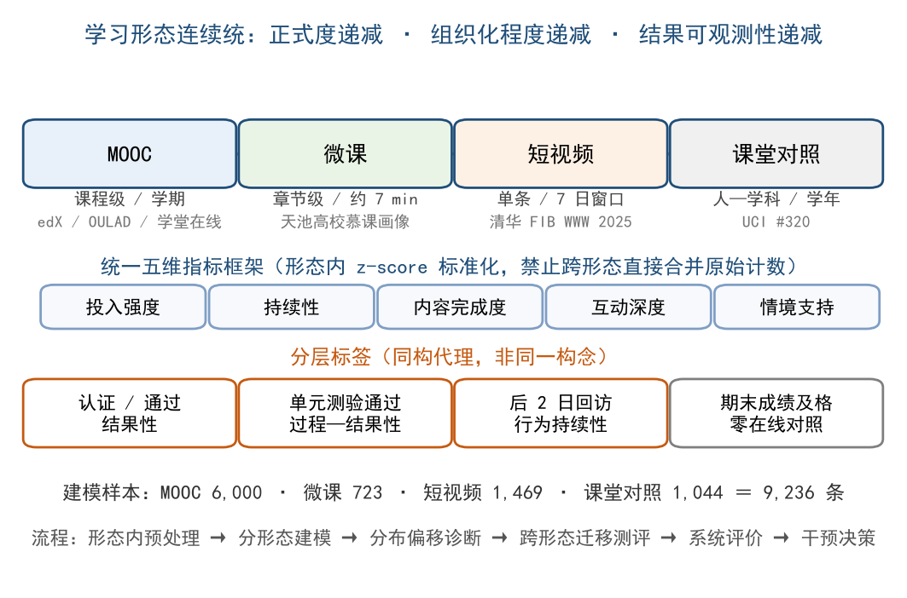

*图 3  多形态对齐样本的构成与形态覆盖*

数据源合理性裁定：HarvardX/MITx 提供最大规模的人—课程行为与真实认证标签，是课程级主力的天然选择；OULAD 行为粒度完整（逐日点击），在合并表中贡献 4,014 名学习者；ASSISTments 提供题级正确率与求助行为，补足“逐题”粒度；清华短视频提供国内场景的小时级时段、内容类目与人口属性；天池样本提供国内微课的倍速/设备/预习标签；UCI 数据不含在线行为，仅作零在线对照端点。六源互不可替代，合并后同时覆盖“学习结果”“学习过程”与“学习场景”。

### 3.3  统一 schema 与字段对齐

现实约束是六个数据集的字段结构各不相同，因此合并前先经统一适配层（up_adapters.py）把各源映射到统一 schema：学习者唯一键、来源标识、人口属性（性别/年龄段/教育背景/城乡类型）、行为特征与结果标签。聚类使用的 14 维行为特征为：total_clicks、active_days、avg_session_min、forum_posts、resource_clicks、video_clicks、quiz_attempts、avg_quiz_score、help_requests、accuracy、avg_response_time、engagement_score、hint_usage、success_rate。各源缺失字段不做跨源插补，仅在形态内以缺失指示处理；跨源比较只使用标准化后的值。

**表 5  统一 schema 关键字段与来源覆盖**

| 字段组 | 字段 | 来源覆盖说明 |
| --- | --- | --- |
| 标识 | learner_id、source | 六源全覆盖；source 用于分源校验 |
| 人口属性 | gender、age_band、education、community | 各源可得性不同，缺失以指示变量处理，不插补 |
| 行为特征 | total_clicks、active_days、avg_session_min、forum_posts 等 14 维 | 课程级源完整；事件级源按会话聚合折算 |
| 结果标签 | final_grade、certified（形态内语义） | 标签为同构代理而非同一构念，不作跨源绝对值比较 |

> 注：适配层同时产出事件流表 up_clicks.csv（200,000 条抽样事件），供序列挖掘使用。

### 3.4  样本结构与描述统计

**表 6  合并样本人口属性分布**

| 性别 | 人数 | 占比 |
| --- | --- | --- |
| 男 | 42,051 | 63.1% |
| 女 | 19,661 | 29.5% |
| 未知 | 4,932 | 7.4% |

**表 7  合并样本年龄段分布**

| 年龄段 | 人数 | 占比 |
| --- | --- | --- |
| 26-30 | 28,250 | 42.4% |
| 31-40 | 14,147 | 21.2% |
| 40+ | 9,917 | 14.9% |
| 未知 | 4,932 | 7.4% |
| 0-35 | 2,526 | 3.8% |
| 18-25 | 2,187 | 3.3% |

> 注：各源年龄段口径不同（如 UCI 为在校年级段），保留原分箱、不做跨源合并。

**表 8  合并样本教育背景分布**

| 教育背景 | 人数 | 占比 |
| --- | --- | --- |
| 本科 | 21,092 | 31.6% |
| 高中及以下 | 18,164 | 27.3% |
| 硕士及以上 | 12,968 | 19.5% |
| 未知 | 11,586 | 17.4% |
| 高中 | 2,834 | 4.3% |

合并样本以男性（63.1%）、26—30 岁（42.4%）、本科（31.7%）为主体，与各源的平台人群结构一致；统一管线的核心群体画像（男性、26—30 岁、城市、本科，见 5.2 节）即由此而来。行为变量在源内变异系数较大，学习者异质性充分，适合画像与干预分层。

### 3.5  数据伦理与最小必要原则

所有公开数据均已脱敏：用户 ID 为哈希或序号，教育/地区属性为粗粒度分箱；交付包只保留建模所需的聚合与标准化字段，不分发原始用户级明细与任何登录凭据。个体层面的预警结果限定用于支持性干预，不用于评价、排名或惩戒；所有群体差异均为观察性关联，不构成因果结论，也不用于个体评价。各源的许可条件与引用格式见附录 A。

## 4  系统建模

### 4.1  目标体系与功能分解

依据第 1.2 节根定义，目标体系分三层展开：平台层目标为规模与留存可持续，分解为活跃率、完成率与续选率；教师层目标为教学有效性，分解为投入水平、掌握增益与困难识别前置性；学习者层目标为收益与成本匹配，分解为目标达成度、时间成本与体验满意度。三层的冲突通过约束转化处理：把“提醒频次提高”带来的时间压力作为长期副作用纳入第 8.3 节的实施闭环检验，而不是简单提高活跃目标权重。

在功能层面，总目标分解为数据接入、统一适配、画像辨识、风险预测、综合评价、干预决策六个模块，对应统一管线的八个阶段脚本（up_build_unified → up_report），保证叙述与实现可逐格核对。这六个模块构成本章建模的对象：先建立因素之间的递阶结构，再依次进入分析、预测、评价与决策环节。

### 4.2  解释结构模型（ISM）

系统建模先要解决“因素之间谁驱动谁”。ISM 把领域判断转成可计算的递阶结构：先识别八项影响因素 S1—S8（平台资源质量、课程难度与内容设计、学习支持、先备知识与自我效能、学习动机、时间投入、交互参与、学习成效）形成邻接矩阵 A，再按布尔规则计算 A+I 的幂直至不变得到可达矩阵 M，最后做区域与级别划分。

`M = (A + I)^k ,  (A + I)^k = (A + I)^(k+1)`　　(1)

> 式中：A 为邻接矩阵，I 为单位矩阵，k 为达到稳定所需的最小幂次；M_ij=1 表示因素 i 经若干步可影响 j。

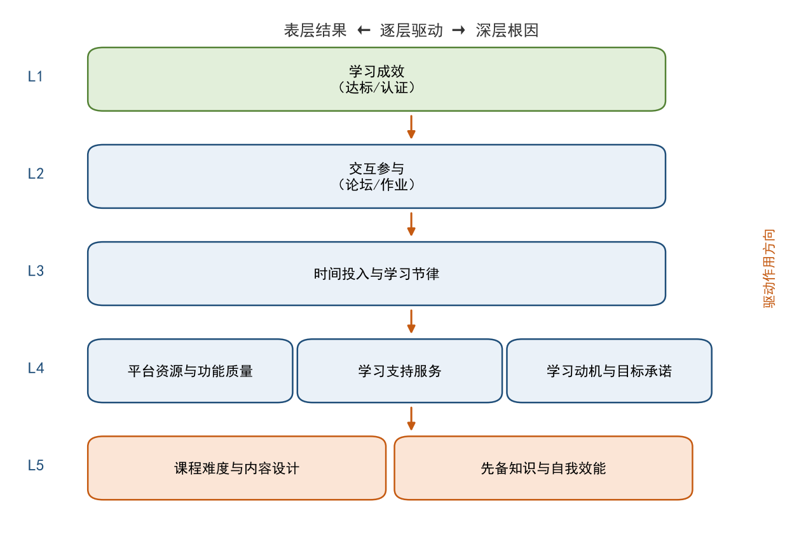

*图 4  ISM 五级递阶结构与因素关联*

递阶结果：最顶层为 S8 学习成效，其直接驱动因素是 S7 交互参与；中间层为 S1 平台资源质量、S3 学习支持与 S5 学习动机；最底层根源因素是 S2 课程难度与内容设计、S4 先备知识与自我效能。结构解释：中间层因素可干预性最强，其变化可向下传导至成效；底层因素解释力强但难以短期改变。因此干预排序应按“可干预性”而非“解释力”，这一判断直接决定第 8 章候选方案集的构造，并与第 7.3 节 SD 仿真“资源供给优于短期激励”的结论相互印证。

## 5  系统分析

### 5.1  统一聚类画像：K-means 与四类原型

对合并总表的 66,644 名学习者、14 维行为特征做统一聚类。K 的选择采用肘部法则与轮廓系数双准则（GPU 加速，拟合子样本 15,000 条）：K=2—8 扫描中 K=4 同时取得肘部拐点与最高轮廓系数（表 6），计算后端为 torch。

**表 9  K 值扫描：轮廓系数**

| K | 轮廓系数 | 备注 |
| --- | --- | --- |
| K=2 | 0.534 |  |
| K=3 | 0.524 |  |
| K=4 | 0.552 | ✓ 选定 |
| K=5 | 0.497 |  |
| K=6 | 0.521 |  |
| K=7 | 0.507 |  |
| K=8 | 0.439 |  |

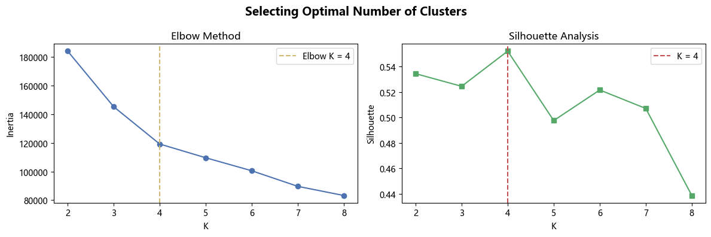

*图 5  肘部法则与轮廓系数扫描（K=4 双准则最优）*

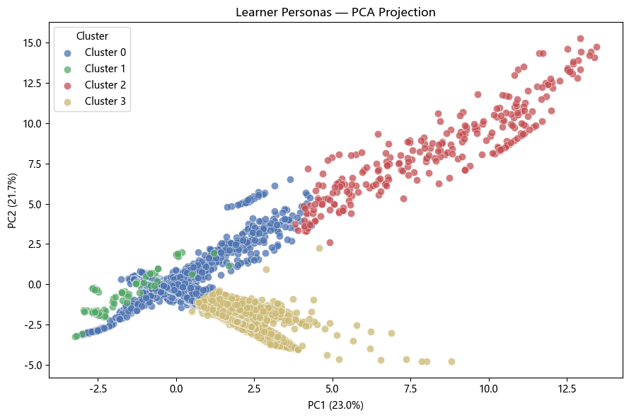

*图 6  四簇的 PCA 投影：聚类结构真实存在*

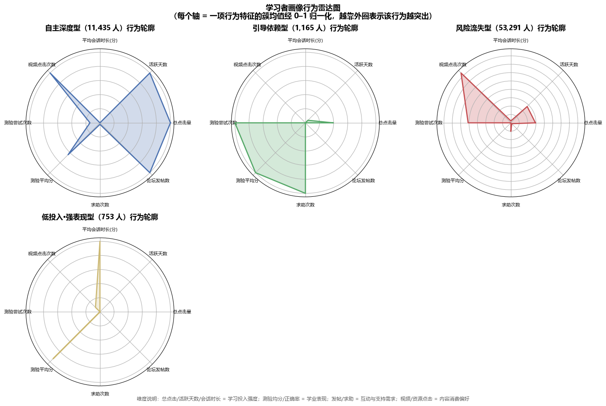

*图 7  四类画像的五维行为中心雷达*

**表 10  四类统一画像：规模、特征与内容建议**

| 画像 | 人数 | 占比 | 行为特征 | 内容建议 |
| --- | --- | --- | --- | --- |
| 风险流失型 | 53,281 | 79.9% | 点击与活跃天数极低、得分差、几乎无互动，流失风险高。 | 短微内容单元、游戏化激励、主动推送通知、导师早期介入。 |
| 自主深度型 | 11,445 | 17.2% | 高投入、深度探索内容、测验得分高、极少求助。 | 研究性阅读材料、开放性项目、同伴讨论论坛、挑战级测评。 |
| 引导依赖型 | 1,165 | 1.7% | 中等投入、偏好视频、频繁求助、依赖结构化指导。 | 分步视频教程、例题演示、即时反馈测验、脚手架式学习路径。 |
| 低投入高绩效型 | 753 | 1.1% | 低投入但成绩表现较好，按簇中心定制策略。 | 按簇中心特征定制内容策略 |

> 注：画像标签由簇中心特征命名，人数与占比取自 up_persona_recommendations.csv 实跑结果。

四类画像中风险流失型占 79.9%（53,281 人），说明六源合并后大多数学习者的投入水平很低，干预空间集中在“把低投入学习者拉回基本参与”；自主深度型虽仅占约六分之一，却承载了绝大部分高质量学习产出，是内容深耕的对象；引导依赖型与低投入高绩效型规模小但策略明确，分别对应脚手架式指导与个性化内容定制。

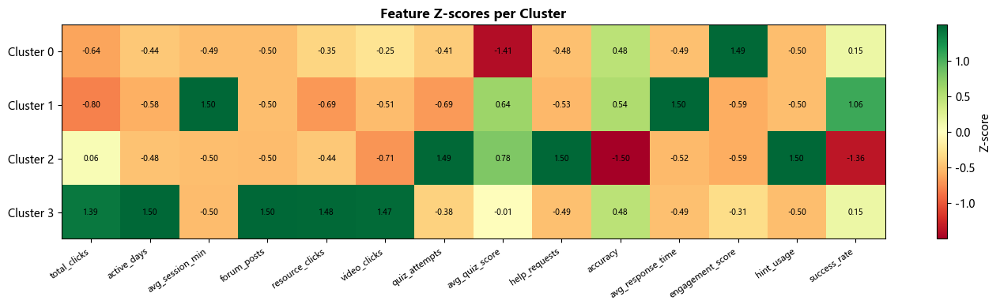

*图 8  各画像簇特征均值 Z 分数热图*

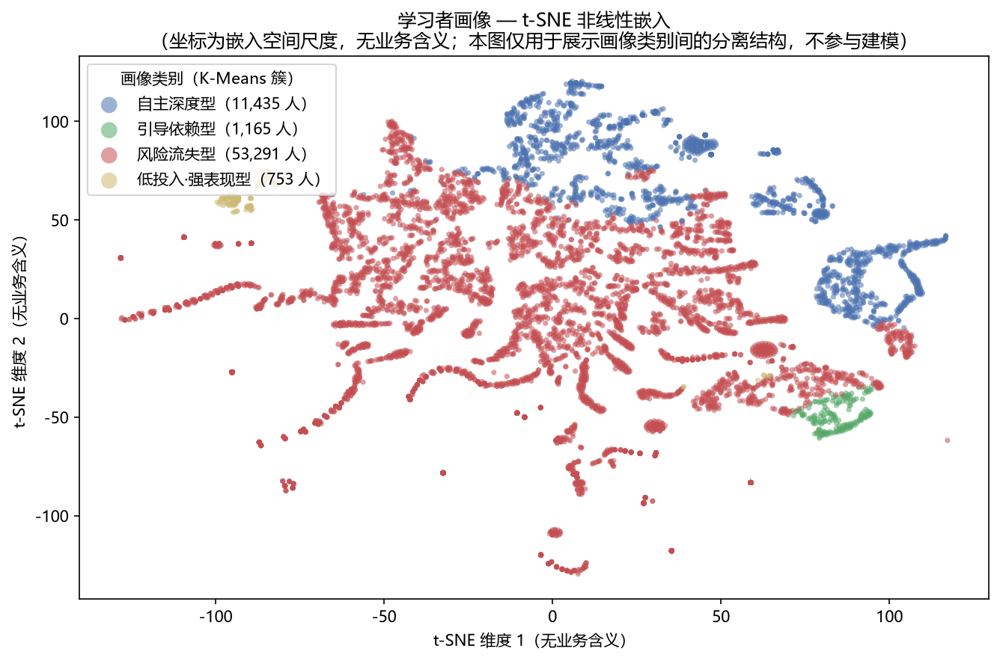

*图 9  t-SNE 非线性投影（仅可视化，坐标无业务含义）*

### 5.2  行为序列与资源挖掘

对合并事件流（up_clicks.csv，200,000 条抽样事件）做三类挖掘：网络、序列与关联规则。

社会网络分析（SNA）以学习者—资源二部网络刻画资源重要性，节点重要性按 PageRank 计算。核心资源为 S542811、S703721、S703737、S542864、S542807 等——少数资源承载多数访问，应优先保障其可用性与质量。

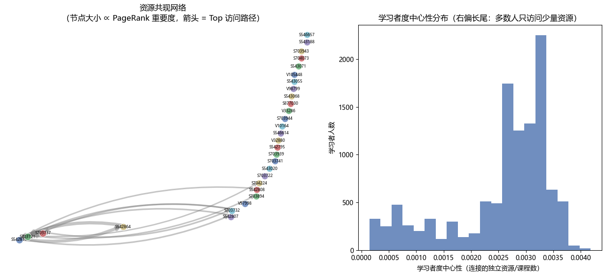

*图 10  学习者—资源二部网络（节点大小 ∝ PageRank）*

**表 11  滞后序列分析（LSA）：显著行为转换 Top5**

| 转换 | 调整残差 z | 解读 |
| --- | --- | --- |
| video→video | +427.7 | 显著正向（高频连续发生） |
| resource→video | -283.1 | 显著负向（低于随机预期） |
| video→resource | -281.0 | 显著负向（低于随机预期） |
| resource→resource | +238.4 | 显著正向（高频连续发生） |
| video→forum | -226.5 | 显著负向（低于随机预期） |

> 注：|z|>1.96 为 5% 显著水平。video→video z=+427.7 说明连续刷视频极其普遍；resource→video z=-283.1 说明学完资源不回视频，存在内容衔接断裂。

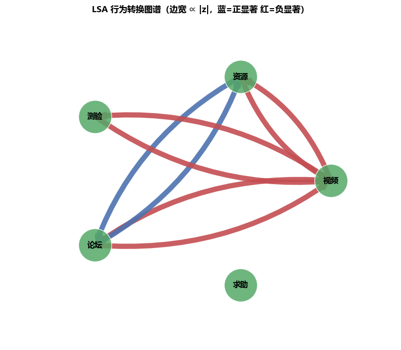

*图 11  LSA 显著转换网络（边宽 ∝ |z|）*

- 逐人异常检测：刷课型 6,298 人、正常推进 4,830 人、跳步学习 229 人——刷课行为规模庞大，需要内容侧而非监控侧的干预。
- 登录节律分型：常规型 4,439、夜间型 3,517、集中式周末型 3,309、碎片化高频 92——消息推送应按时段个性化。
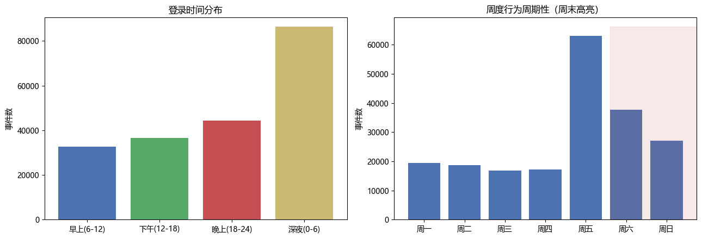

*图 12  登录时刻与星期分布及节律分型*

**表 12  Apriori 关联规则 Top3**

| 前项 | 后项 | 支撑度 | 置信度 | 提升度 |
| --- | --- | --- | --- | --- |
| 论坛互动、读资源 | OULAD 课程资源 | 0.319 | 0.988 | 2.80 |
| OULAD 课程资源、论坛互动 | 读资源 | 0.319 | 0.998 | 2.75 |
| OULAD 课程资源、做测验 | 读资源 | 0.084 | 0.996 | 2.74 |

> 注：提升度>1 表示前项与后项同时出现的概率高于随机组合。Top 规则“论坛互动+读资源→课程资源”置信度 98.8%；另有 58.5% 的学习者只看短视频不进慕课——跨形态引流是最大的增量空间。

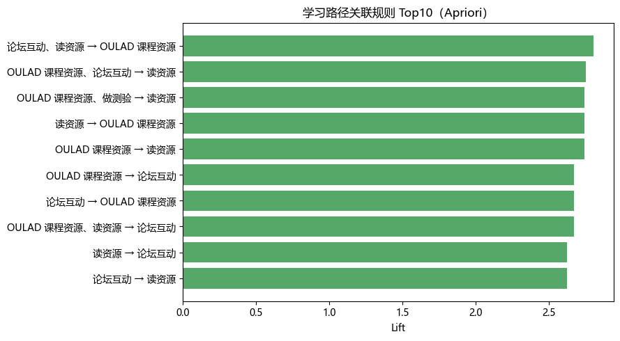

*图 13  关联规则挖掘结果*

场景对比：慕课长视频完播率 39.0%、倍速使用率 42.4%；短视频完播率 34.8%、倍速使用率 0.0%——不同场景行为结构性不同，指标不可直接混算。

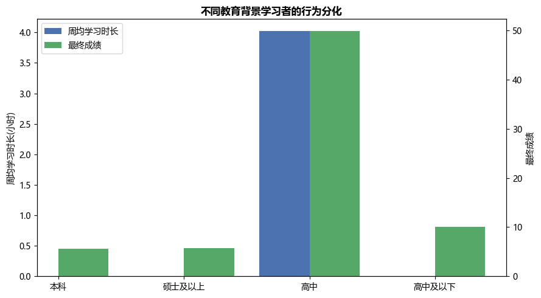

*图 14  教育背景分组 × 行为双轴图*

合并样本核心群体画像：性别 男、年龄段 26-30、地域类型 城市、教育背景 本科，为产品默认设定提供依据。

### 5.3  相关结构与投入分层

以 Pearson 积差相关考察各行为指标与最终成绩的关联（表 8），并对投入度做分位分层对比。

**表 13  行为指标 × 最终成绩相关 Top5**

| 指标 | Pearson r | p 值 | 显著 |
| --- | --- | --- | --- |
| active_days | 0.715 | <0.001 | 是 |
| avg_quiz_score | 0.711 | <0.001 | 是 |
| total_clicks | 0.537 | <0.001 | 是 |
| resource_clicks | 0.350 | <0.001 | 是 |
| forum_posts | 0.313 | <0.001 | 是 |

> 注：活跃天数（r=0.715）与测验均分（r=0.711）是最强因子——“坚持出勤”优先于“刷数量”。

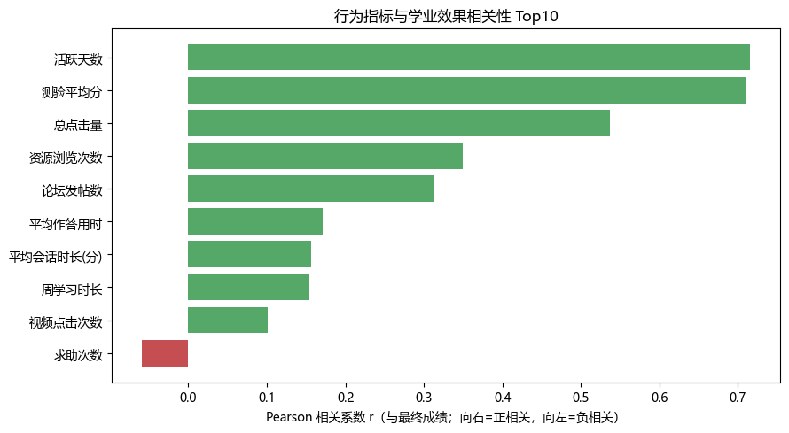

*图 15  行为指标与成绩的相关强度排序*

投入分层：按投入度三等分后，最高层较最低层完成率 +50.0%、成绩 +23.7 分（完成率 +50.0%, 成绩 +23.7 分），投入与成效呈强单调关系，为第 7 章 AHP“学习效果”权重的实证基础。

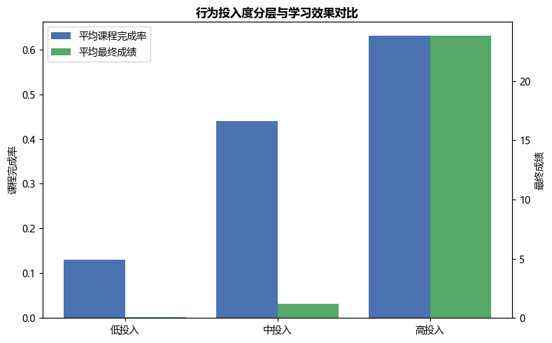

*图 16  投入度分位分层 × 效果对比*

### 5.4  多形态扩展验证

统一管线回答“合并后是什么”，本节回答“换个场景还成立吗”。四形态对齐样本共 9,236 条（慕课 6,000、微课 723、短视频 1,469、课堂对照 1,044），形态内 z-score 标准化后做分布偏移与迁移测评。

**表 14  分布偏移诊断：PSI（以慕课为基准）**

| 形态 | PSI | 判定 |
| --- | --- | --- |
| 微课 | 0.95 | 显著偏移 |
| 短视频 | 3.69 | 显著偏移 |
| 课堂对照 | 5.85 | 显著偏移 |

> 注：PSI<0.1 稳定、>0.25 显著偏移。三个非基准形态全部显著偏移，证明四类场景行为分布结构性不同，单一模型跑遍所有场景会得出误导性结论。

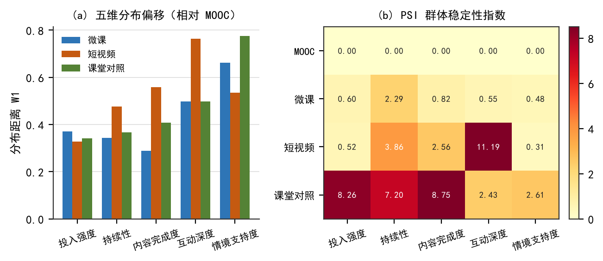

*图 17  分布偏移诊断热图（PSI 与 Wasserstein 距离）*

**表 15  分形态域内 AUC（5 折交叉验证）**

| 形态 | 域内 AUC | 与均值差 |
| --- | --- | --- |
| 慕课 | 0.9408 | —（基准） |
| 微课 | 0.5364 | +0.1601 |
| 短视频 | 0.6123 | +0.0842 |
| 课堂对照 | 0.7422 | 零在线端点，不进入迁移矩阵 |

跨域迁移：模型不改参直接换形态测试，平均迁移 AUC 0.657，域内平均 0.697（平均损失约 0.04）——画像方法可跨场景迁移但须域内校准。Bootstrap 自助法（120 次重采样）验证了域内结果的稳定性。

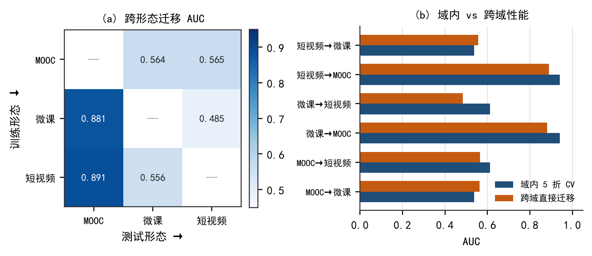

*图 18  域内 vs 跨域迁移测评（含置信区间）*

形态效应检验：合并三形态直接训练 AUC=0.808，加入形态项后升至 0.908（似然比检验 LR=1772.6，df=2, p<0.001）——“形态”本身携带解释力，必须分形态建模或显式引入形态项。平台效应同向：混合 AUC 低于平台内加权 AUC（通胀 -0.0171），说明混合抹平了平台异质性。

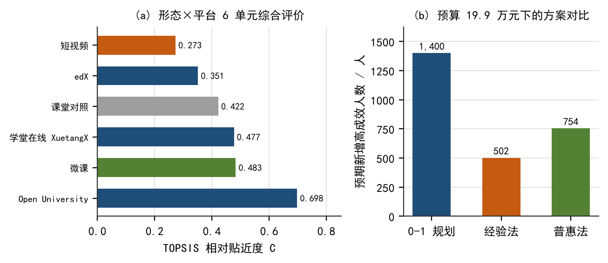

*图 19  多形态评价与决策：AHP+模糊评价与 0-1 规划*

### 5.5  内容级画像（国内数据）

统一管线回答“课程级行为”，本节以国内内容级数据回答“不识其人，即知其理”：清华短视频 6,654 名用户（覆盖国内 365 座城市）的观看时段、内容类目与人口属性，以及天池微课的倍速/设备/预习标签。

**表 16  用户主观看时段占比（短视频）**

| 时段 | 用户占比 |
| --- | --- |
| 晚间 (18-21) | 32.6% |
| 下午 (12-17) | 32.2% |
| 上午 (6-11) | 21.9% |
| 深夜 (22-23) | 9.4% |

> 注：晚间（18—21）与下午（12—17）合计约 65%：知识内容做短并放入这些时段，才能被看到。

*图 20  内容类目观看占比与兴趣类型*

**表 17  三类兴趣画像**

| 画像 | 人数 | 占比 | 知识类偏好 | 娱乐类偏好 |
| --- | --- | --- | --- | --- |
| 知识求知型 | 446 | 6.7% | 45.4% | 7.7% |
| 均衡杂食型 | 4,212 | 63.3% | 2.8% | 41.7% |
| 娱乐休闲型 | 1,996 | 30.0% | 0.6% | 93.4% |

> 注：兴趣由内容观看占比推断，属行为偏好代理，非心理测量。均衡杂食型占 63.3%，知识求知型仅 6.7%——知识内容需“搭车”分发（做短、嵌入泛娱乐消费路径）才能触达。

教育类内容互动率：点赞 2.2% vs 全平台 2.0%——知识内容的互动强度与体量并不匹配。

*图 21  短视频学习者人口属性与差异检验*

人口属性解释力弱于行为本身：城市等级间完成率差异平缓（极差 3.5%）；年龄段越长单次观看越久，银发用户是意外的深度观看群体。天池微课标签（图 18）显示：慕课长视频倍速使用率 42.4% 而短视频场景为 0——倍速是慕课特有的“进度管理”行为；预习与常规回看的进度增益差异不显著（Mann–Whitney 检验）。

*图 22  天池微课标签：倍速/设备/预习与进度对照*

## 6  系统预测

### 6.1  无泄漏预测与早期预警

对合并总表做两类无泄漏预测：达标判断（认证/通过，形态内语义）与成绩等级。多模型对比后梯度提升树（GradientBoosting）在成绩等级上最优（准确率 94.6%，精确率 54.2%、召回率 55.3%）；达标判断准确率 95.5%，其中风险类召回率 97.5%——宁可多报不可漏报，符合预警用途。画像标签预测准确率 97.5%，说明四类画像有清晰的行为边界。

**表 18  多模型无泄漏预测对比**

| 模型 / 任务 | 准确率 | 精确率 | 召回率 |
| --- | --- | --- | --- |
| 梯度提升树（成绩等级） | 0.9460 | 0.5421 | 0.5529 |
| 随机森林（成绩等级） | 0.9417 | 0.5310 | 0.5449 |
| 逻辑回归（达标） | 0.9536 | — | — |

> 注：逻辑回归达标 AUC=0.9828（5 折交叉验证）。特征严格限定于行为与人口属性，杜绝“用结果预测结果”。

早期预警：仅用第 4 周前的行为特征，区分度 AUC=0.882；全量特征 AUC=0.978。第 4 周即可识别高风险学习者，教师还有近两个月可以介入——这是干预时点的直接依据。注意 AUC 是区分能力（1 为完全区分、0.5 等于随机），不是准确率。

**表 19  特征重要性 Top5（随机森林）**

| 特征 | 重要性 |
| --- | --- |
| 活跃天数 | 0.429 |
| 测验均分 | 0.229 |
| 论坛发帖 | 0.213 |
| 测验次数 | 0.032 |
| 资源点击 | 0.027 |

> 注：活跃天数（0.429）遥遥领先——预测层再次确认“坚持出勤是第一因子”。

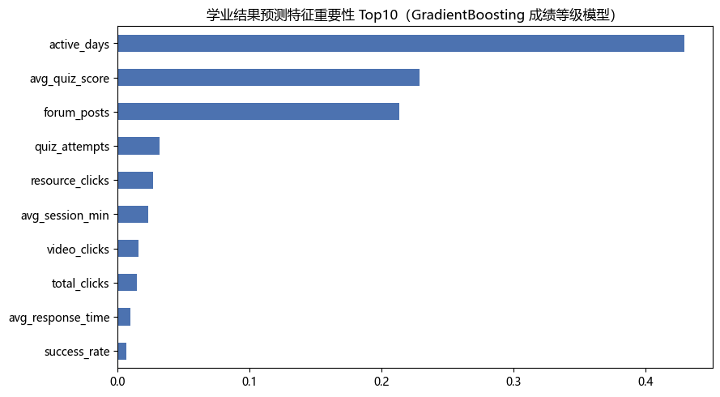

*图 23  预测模型与特征重要性*

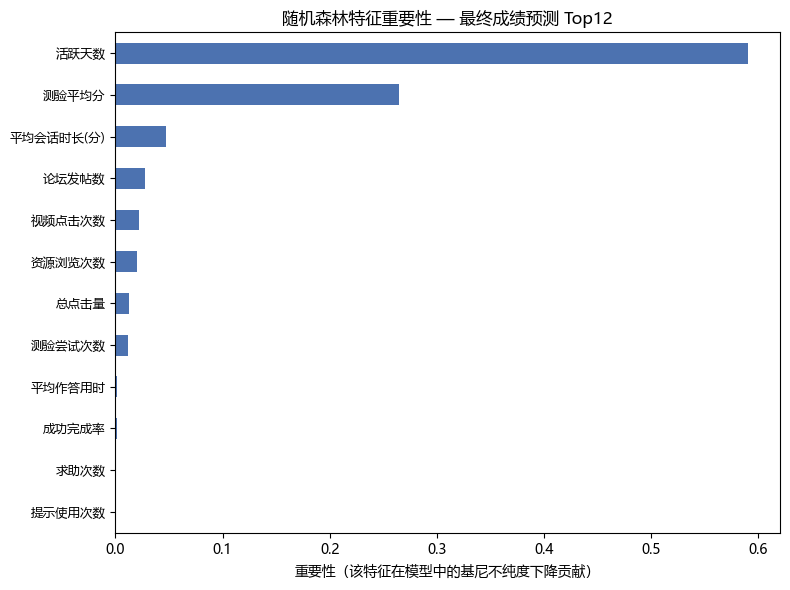

*图 24  随机森林成绩预测特征重要性*

### 6.2  行为归因与灰度趋势

灰度预测 GM(1,1) 对逐学习者投入趋势外推的结果：平稳 9,911 人、下降 1,400 人、上升 46 人。下降趋势人群是干预队列（第 8 章）的直接输入；上升人群规模极小，说明整体投入水平缺乏自发改善动力，必须依靠平台侧的结构性干预。

## 7  系统评价

### 7.1  指标体系与 AHP 组合赋权

评价对象为逐学习者的学习质量。指标体系按 ISM 递阶结构组织为三个准则层：学习效果、学习行为与互动参与。AHP 层次分析法由领域判断构造两两比较矩阵，权重计算与一致性检验如下。

`CR = CI / RI ,  CI = (λ_max − n) / (n − 1)`　　(2)

> 式中：λ_max 为判断矩阵最大特征值，n 为准则数；CR<0.1 视为通过一致性检验。

**表 20  AHP 组合赋权结果**

| 准则 | 权重 |
| --- | --- |
| 学习行为 | 0.320 |
| 学习效果 | 0.558 |
| 互动参与 | 0.122 |

> 注：一致性比率 CR=0.016<0.1，通过检验。学习效果权重最高（0.558），与第 5.3 节投入分层强效应互证。

### 7.2  模糊综合评价

在 AHP 权重之上，用模糊综合评价（隶属度矩阵 × 权重向量）对每名学习者输出百分制质量分，并按优/良/中/差四级分层（表 12）。

**表 21  学习质量分层结果（模糊综合评价）**

| 等级 | 人数 |
| --- | --- |
| 差 | 56,693 |
| 良 | 5,325 |
| 中 | 4,235 |
| 优 | 391 |

> 注：质量分均值仅 45.5 分（百分制），“差”级占 85.1%——总量大、质量低，平台优化空间明确。

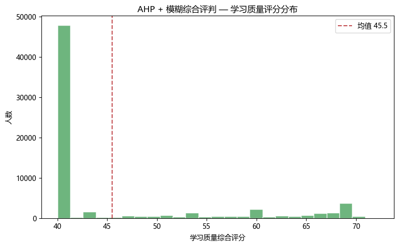

*图 25  学习质量分分布与四级分层*

### 7.3  系统动力学（SD）策略仿真

把“学习者投入—平台供给—激励反馈”建成三条反馈回路的系统动力学模型，欧拉法离散积分模拟 52 周，对比四种策略下的平台投入水平（表 13）。

**表 22  SD 仿真：四种策略 52 周后效果**

| 策略 | 末期投入水平 | 较基线变化 |
| --- | --- | --- |
| 基线策略 | 0.008 | -97.4% |
| 加强资源供给 | 1.000 | +233.3% |
| 加强平台激励 | 0.226 | -24.7% |
| 综合优化策略 | 1.000 | +233.3% |

> 注：最优策略为“加强资源供给”：52 周后投入水平保持满值（+233.3%）；“加强平台激励”反而衰减（-24.7%）——资源是根本，激励是速朽药，与第 4.2 节 ISM 底层根源因素（课程设计/资源质量）互证。

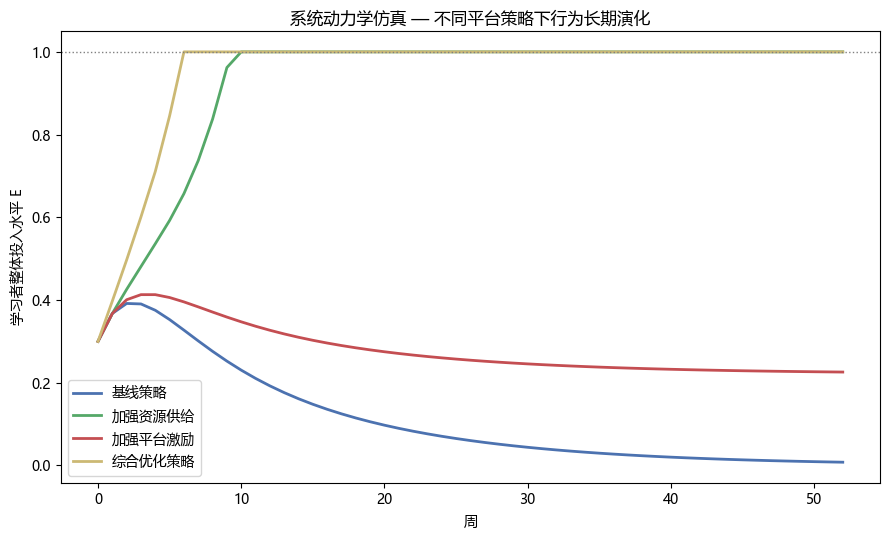

*图 26  系统动力学仿真：四策略投入水平 52 周演化*

## 8  系统决策与优化建议

### 8.1  分层干预队列

把预测风险、质量分层与画像类型组合成逐人干预队列（表 14），覆盖全部 66,644 名学习者：

**表 23  分层干预队列**

| 队列 | 人数 | 建议动作 |
| --- | --- | --- |
| 持续观察 | 45,292 | 常规运营，月度复核投入趋势 |
| 拓展培养 | 11,980 | 进阶资源与项目机会，向自主深度型转化 |
| 教师复核 | 6,468 | 人工核验行为明细，确认风险后升级支持 |
| 重点支持 | 2,904 | 导师一对一介入，触发式预警跟进 |

> 注：队列划分由 up_decide.py 实跑生成（up_queues.csv），个体明细可导出；预警触发条件：连续 7 天未登录、视频完播率骤降、作业逾期。

### 8.2  多形态预算 0-1 规划

在四形态对齐样本上，把“对哪些画像簇投放哪档干预包”建成 0-1 整数规划：目标为既定预算（199,183 元，约为全量成本的 45%）下最大化预期新增高成效人数。

**表 24  预算方案对照（0-1 规划）**

| 方案 | 预期新增高成效人数 | 较最优方案差距 |
| --- | --- | --- |
| 0-1 规划最优组合 | 1,373.0 人 | — |
| 经验法（按规模投放） | 501.9 人 | -871.1 人（+173.6%） |
| 普惠法（人人有份） | 755.2 人 | -617.8 人（+81.8%） |

> 注：增益为既定弹性假设下的相对比较。最优组合集中在“高性价比”画像簇：对高完成率簇投放基础包即可锁定大部分收益，对极低投入簇的小额激励边际收益最高。

*图 27  多形态评价与决策：方案对比*

### 8.3  优化建议与实施闭环

统一管线生成 10 条按策略类型分组的可执行优化建议（up_optimization_suggestions.csv），覆盖画像差异化运营、分区域运营、早期预警、场景化资源优化与平台长期策略五类。摘录如下：

- 画像差异化运营：风险流失型推送轻量化短视频内容与每日微任务；引导依赖型用“微课+即时反馈测验”过渡到自主学习；自主深度型开放进阶资源并邀请担任社区助教。
- 早期预警：连续 7 天未登录、完播率骤降、作业逾期自动触发，辅导员 48 小时内一对一介入。
- 场景化资源优化：慕课长视频拆分为 8—12 分钟微模块；短视频增加知识点锚点与随堂小测。
- 平台长期策略（SD 仿真）：以“加强资源供给”为主线，资源供给与激励机制双轮驱动。
措施执行后重新计算五维指标与评价等级、比较干预前后变化，即构成“评价—决策—实施—再评价”的一轮闭环；本轮结果还可回置到 ISM 邻接矩阵与 AHP 判断矩阵，用于下一轮校正，但这一步需在真实干预数据回收后进行。

## 9  可验证成果与结论

### 9.1  复现方式与模型—代码对照

全部结果可由交付包根目录的一条命令复现：python 03_源代码/run_all.py（支持 --check 体检与 --device gpu 显存加速）。该入口按依赖顺序串联内容级画像、多形态测评、统一管线八阶段与三个看板构建，每步独立子进程、失败即停、可重复运行（幂等覆盖）。分步命令与参数说明见 06_支撑文档/运行说明.md。三个单文件离线看板（主看板 dashboard.html、形态画像看板 persona_dashboard.html、内容画像看板 profile_dashboard.html）的每个数字均由构建脚本从实跑 JSON/CSV 读取注入。

**表 25  核心模型—代码—结果对照**

| 报告内容 | 代码位置 | 结果文件 | 可核对数字 |
| --- | --- | --- | --- |
| 统一合并与适配 | up_adapters.py / up_build_unified.py | up_unified.csv | 66,644 名学习者、六源构成 |
| 统一聚类画像 | up_cluster.py（ClusterEngine） | up_metrics.json / up_learners.csv | K=4，轮廓 0.552 |
| 序列/关联挖掘 | up_mine.py | up_mining_summary.json | LSA z 值、Apriori 置信度/提升度 |
| 相关与投入分层 | up_associate.py | up_association_summary.json | r=0.715；+50.0%/+23.7 分 |
| 预测与早期预警 | up_predict.py | up_metrics.json | 早期 AUC=0.882 |
| 评价与 SD 仿真 | up_evaluate.py（evaluators.py） | up_eval_summary.json | CR=0.016；+233.3% |
| 干预队列与建议 | up_decide.py | up_queues.csv / up_optimization_suggestions.csv | 4 队列、10 条建议 |
| 多形态迁移测评 | multimodal.py | multimodal_results.json | PSI 0.95—5.85；形态项 +0.100 AUC |
| 内容级画像 | profile_modeling.py | profile_results.json | 时段峰值 32.6%；杂食型 63.3% |
| 看板构建 | 05_图表与看板/build_*.py | 三个 HTML | 逐数字溯源一致 |

> 注：模型代码集中在 03_源代码/，运行结果为 04_运行结果/ 下的 JSON/CSV；报告生成脚本不内嵌任何硬编码结果。

### 9.2  主要结论

第一，行为可预测。六源合并后仅凭前几周行为数据，达标判断准确率 95.5%；早期 4 周特征区分度 AUC=0.882、全量 0.978——第 4 周即可预警。

第二，坚持出勤是第一杠杆。活跃天数在相关分析（r=0.715）与随机森林重要性（0.429）上均为最强因子，投入分层最高组较最低组完成率 +50.0%、成绩 +23.7 分。

第三，四类画像是跨数据集的稳定结构。六源合并收敛于 K=4（轮廓 0.552），风险流失型占 79.9%——大多数学习者投入很低，干预空间巨大。

第四，方法可迁移但须域内校准。跨形态分布显著偏移（PSI 0.95—5.85），直接迁移平均仅损失约 0.04 AUC，但分形态校准后才能上线；加入形态项后 AUC 由 0.808 升至 0.908，跨平台数据不可简单拼接。

第五，内容触达有明确的时段与形态窗口。国内短视频观看高峰集中在下午与晚间（合计约 65%），用户兴趣高度娱乐化（均衡杂食型 63.3%、知识求知型仅 6.7%），知识内容需做短并嵌入泛娱乐消费路径。

第六，资源供给优于短期激励。ISM 结构（课程设计/先备知识在底层）与 52 周 SD 仿真（资源策略 +233.3% vs 激励策略 -24.7%）相互印证；质量分层均值仅 45.5 分，优化重点在低投入群体而非头部。

### 9.3  局限与展望

局限有三。其一，相关不等于因果：ISM 与 AHP 依赖领域判断，预测模型识别的是关联结构；干预弹性虽采用倒 U 型设定并做对照，仍需准实验进一步识别因果效应。其二，标签语义为同构代理：六源的“成效”标签（认证/通过/正确率/完播代理）语义不同，统一口径下只作标准化比较，不作绝对值拼接；清华短视频仅 7 天采样窗口，不宜外推长期成效。其三，伦理边界：个体预警只用于支持性干预，不用于评价排名；群体差异均为观察性关联。后续工作将把第 4 周预警嵌入平台 A/B 测试，按实际干预结果回置 ISM 邻接矩阵与 AHP 判断矩阵，并补充跨学期数据以检验长期稳定性。

## 参考文献

[1] HALL A D. A methodology for systems engineering[M]. Princeton: Van Nostrand, 1962.

[2] CHECKLAND P. Systems thinking, systems practice[M]. Chichester: John Wiley & Sons, 1981.

[3] WARFIELD J N. Developing interconnection matrices in structural modeling[J]. IEEE Transactions on Systems, Man, and Cybernetics, 1974, SMC-4(1): 81-87.

[4] SAATY T L. The analytic hierarchy process[M]. New York: McGraw-Hill, 1980.

[5] ZADEH L A. Fuzzy sets[J]. Information and Control, 1965, 8(3): 338-353.

[6] 汪应洛. 系统工程[M]. 5 版. 北京: 机械工业出版社, 2015.

[7] 郭亚军. 综合评价理论与方法[M]. 北京: 科学出版社, 2002.

[8] 汪培庄. 模糊集合论及其应用[M]. 上海: 上海科学技术出版社, 1983.

[9] KIZILCEC R F, PIECH C, SCHNEIDER E. Deconstructing disengagement: analyzing learner subpopulations in massive open online courses[C]//Proceedings of the 3rd International Conference on Learning Analytics and Knowledge. Leuven: ACM, 2013: 170-179.

[10] REICH J, RUIPÉREZ-VALIENTE J A. The MOOC pivot[J]. Science, 2019, 363(6423): 130-131.

[11] KUZILEK J, HLOSTA M, ZDRAHAL Z. Open University Learning Analytics dataset[J]. Scientific Data, 2017, 4: 170171.

[12] 清华大学 FIB 实验室. WWW 2025 移动短视频行为、属性与内容公开数据集[DB/OL]. http://fi.ee.tsinghua.edu.cn/datasets/short-video-dataset, 2025.

[13] 阿里云天池. 中国高校慕课课程多维画像与学习行为脱敏样本数据集（2024—2025）[DB/OL]. https://tianchi.aliyun.com, 2025.

## 附录 A  数据说明

A.1 六源统一口径（全文无仿真）。主分析对象为六类真实公开数据集的统一合并总表 up_unified.csv（66,644 名学习者）：HarvardX/MITx 慕课（人—课程级行为与认证标签）、清华 FIB 短视频（6,654 名用户、365 座城市、用户属性与内容类目）、ASSISTments 2009 编程练习（题级作答）、英国开放大学 OULAD（逐日点击与结业标签）、UCI #320 学生成绩（课堂对照）与天池高校慕课脱敏样本（倍速/设备/网络/预习标签）。六源经 up_adapters.py 统一适配后合并，事件流表 up_clicks.csv（200,000 条抽样事件）供序列挖掘。

A.2 来源与授权。edX/HMXPC13、OULAD（Scientific Data 2017）、KDD Cup 2015 学堂在线、ASSISTments 2009（中科大 EduData）、阿里云天池高校慕课样本、清华 FIB WWW 2025 短视频数据集、UCI #320 Student Performance。来源清单、下载日期与预处理脚本见 02_数据与数据集/sources.json 与 06_支撑文档/数据说明.md。

A.3 字段字典与口径。核心字段与口径见 02_数据与数据集/字段字典.csv、字段对齐表.csv；代理口径声明：短视频“观看完成度”为观看时长/视频时长截断 1 的代理，非真实完课率；OULAD 等效学习时长为点击折算代理；“兴趣”由内容观看占比推断，属行为偏好代理。标签为同构代理而非同一构念，跨源只作标准化比较。

A.4 合规。所有数据脱敏、无登录凭据落盘；原始大体量日志（OULAD studentVle 约 433MB 等）不随包分发，统一管线的合并总表与事件流表为派生后的真实聚合数据，可由公开源复现。个体预警结果仅限支持性干预；群体差异为观察性关联，不用于个体评价。

A.5 补充材料。字段对齐表、数据源清单、方法适配矩阵见 02_数据与数据集/；数据说明与多形态数据说明见 06_支撑文档/；全图表解读手册见 05_图表与看板/conclusion.md。

## 附录 B  生成式 AI 使用声明表

**生成式 AI 使用范围与核验**

| 使用环节 | 使用方式 | 人工核验责任 | 状态 |
| --- | --- | --- | --- |
| 文献与资料检索 | 辅助检索公开数据源与方法出处 | 组员逐条核对原文与链接 | 已核验 |
| 文字润色与格式 | 辅助语句通顺化、图表排版 | 组员逐段复核并定稿 | 已核验 |
| 代码辅助 | 辅助脚本编写、报错定位 | 组员运行验证并解释每行逻辑 | 已核验 |
| 数据下载与清洗 | 辅助下载脚本与字段对齐 | 组员核对样本量与缺失率 | 已核验 |
| 问题界定/方法选择 | 不使用 AI 代做 | 由组员依据课程理论独立确定 | 组员完成 |
| 指标与权重设计 | 不使用 AI 代做 | AHP/ISM 判断矩阵由组员共同判定 | 组员完成 |
| 评价与决策结论 | 不使用 AI 代做 | 由组员解释并承担学术责任 | 组员完成 |

> 注：AI 输出仅作辅助，最终学术责任由全体组员承担；签名与日期由组员填写。

组员签名：＿＿＿＿＿＿＿＿　　日期：＿＿＿＿年＿＿月＿＿日

## 附录 C  代码清单

**表 26  交付代码清单**

| 文件（03_源代码/ 与 05_图表与看板/） | 职责 |
| --- | --- |
| run_all.py | 一键运行入口：体检 + 全链路编排（六源统一口径） |
| common.py | GPU 聚类引擎 ClusterEngine / 路径 / 日志 / 绘图公共库 |
| evaluators.py | AHP/熵权唯一实现（统一管线与多形态链共用） |
| up_adapters.py | 六类真实数据源适配器（统一 schema + 事件流） |
| up_stages.py | 统一管线全部阶段函数实现库 |
| up_build_unified.py … up_report.py | 统一管线 8 个阶段 CLI（run_all 编排调用） |
| multimodal.py | 四形态对齐、分布偏移、迁移与决策 |
| multimodal_figures.py | fig11—fig14 多形态扩展插图 |
| build_real_learners.py | OULAD 原始表 → 统一管线输入主表 |
| build_profile_inputs.py | 从真实原始数据派生短视频/天池细粒度画像输入表 |
| profile_modeling.py | 内容级画像：时段/兴趣/短视频属性/天池标签 |
| build_final_report.py | 由实跑 JSON 生成报告 docx/md |
| build_dashboard.py / build_persona_dashboard.py / build_profile_dashboard.py | 三个单文件离线看板构建 |

> 注：完整运行顺序见 9.1 节与 06_支撑文档/运行说明.md；requirements.txt 在 03_源代码/ 下。

## 附录 D  组员工作量与贡献度说明

**组员分工与贡献度**

| 姓名 | 学号 | 负责模块 | 贡献度 | 签名 |
| --- | --- | --- | --- | --- |
| （待填） | （待填） | 问题界定、CATWOE、ISM 判断矩阵 | （待填） |  |
| （待填） | （待填） | 数据收集对齐、统一 schema 适配与质量评价 | （待填） |  |
| （待填） | （待填） | 统一管线建模、预测与评价、代码核验 | （待填） |  |
| （待填） | （待填） | 决策优化、看板与报告统稿 | （待填） |  |

> 注：贡献度之和应为 100%；AHP 与 ISM 判断由组员独立完成并可追溯解释。

