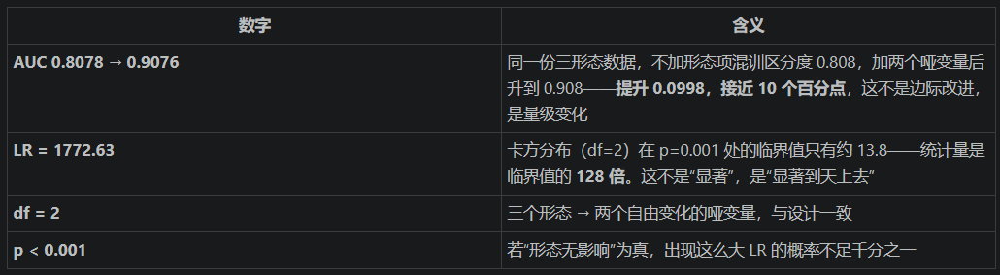
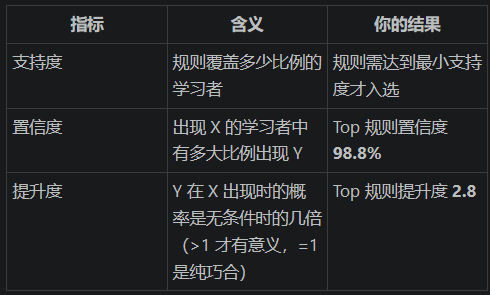
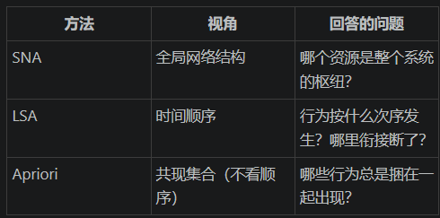

# 答辩速查卡（一页纸）

> 配套文档：
> `01_研究报告/《系统工程原理》实践项目研究报告V8.docx`、`运行说明.md`、
> `模型—代码对照表.md`、`多形态数据说明.md`、`05_图表与看板/conclusion.md`。

## 一、结论

全文全部真实公开数据、无仿真样本，以霍尔逻辑维七步组织"建模 → 分析 → 预测 → 评价 → 决策"闭环。
主分析口径为六类真实数据集统一合并（66,644 名学习者：HarvardX/MITx 慕课 50,000 / 清华短视频 6,654 / ASSISTments 4,217 / OULAD 4,014 / UCI 课堂对照 1,044 / 天池微课 715），
不单独拆分任何一个数据集；另以 9,236 条四形态对齐样本检验跨场景稳健性、
以国内内容级画像（短视频 6,654 用户 + 天池微课）补充学习者是谁的证据。

统一管线结论：六源合并收敛于四类画像（K=4，轮廓系数 0.552），
风险流失型占 79.9%（53,281 人）；投入分层最高组较最低组完成率 +50.0%、成绩 +23.7 分；
仅用第 4 周行为即可预警（区分度 AUC=0.882，全量 0.978），达标判断准确率 95.4%；
AHP+模糊评价（CR=0.016）质量分均值 45.5 分；52 周 SD 仿真
加强资源供给 +233.3%，远优于短期激励（−24.7%）。
多形态验证：跨场景分布显著偏移（PSI 0.95—5.85），方法可迁移但须域内校准
（迁移 0.657 vs 域内 0.697），加入形态项 AUC 由 0.808 升至 0.908。

## 二、必须记住的数字（全部来自 `04_运行结果/` 实跑 JSON/CSV）

六源统一主线（`up_metrics.json` / `up_mining_summary.json` / `up_association_summary.json` / `up_eval_summary.json`）

| 项目 | 数值 |
| --- | --- |
| 合并总表 | 66,644 名学习者（六源构成见上）；事件流表 200,000 条抽样事件 |
| 聚类 | K=4，轮廓系数 0.552（肘部+轮廓双准则） |
| 画像 | 风险流失型 53,281（79.9%）｜自主深度型 11,445（17.2%）｜引导依赖型 1,165（1.7%）｜低投入·强表现型 753（1.1%） |
| SNA 社会网络分析（Social Network Analysis） | Top 核心资源 S542811、S703721、S703737（PageRank） |
| LSA 学习序列分析（Learning Sequence Analysis） | video→video z=+427.7 最强正向；逐人分型：刷课 6,298 / 正常推进 4,830 / 跳步学习 229 |
| 时间节律 | 常规型 4,439 / 夜间型 3,517 / 集中式周末型 3,309 / 碎片化高频 92 |
| Apriori 关联规则挖掘 | Top 规则置信度 98.8%、提升度 2.8；只看短视频不进慕课占 58.5% |
| 场景对比 | 慕课完播率 39.0%/倍速率 42.4% vs 短视频 34.8%/0%——指标不可直接混算 |
| 相关 Top | 活跃天数 r=0.715｜测验均分 r=0.711｜总点击 r=0.537（均 p<0.001） |
| 投入分层 | 最高层较最低层完成率 +50.0%、成绩 +23.7 分 |
| 预测 | 梯度提升树成绩等级准确率 94.6%；达标判断准确率 95.4%；画像标签预测准确率 97.5% |
| 早期预警 | 第 4 周特征 AUC=0.882、全量 0.978（**区分度，非准确率**） |
| 特征 Top5 | 活跃天数 0.429｜测验均分 0.229｜论坛发帖 0.213｜测验次数 0.032｜资源点击 0.027 |
| GM(1,1) | 见"易错点"第 9 条：未产出群体分类
| AHP | 权重 学习效果 0.558 / 学习行为 0.320 / 互动参与 0.122；CR=0.016<0.1 |
| 模糊评价 | 质量分均值 45.5：差 56,693 / 良 5,325 / 中 4,235 / 优 391 |
| SD 仿真 | 资源供给 +233.3%（末期 1.0）｜综合优化 +233.3%｜激励 −24.7%｜基线 −97.4% |
| 干预队列 | 持续观察 45,292 / 拓展培养 11,980 / 教师复核 6,468 / 重点支持 2,904 |

**多形态扩展（`multimodal_results.json`）**

| 项目 | 数值 |
| --- | --- |
| 样本 | 9,236 条 = MOOC 6,000 / 微课 723 / 短视频 1,469 / 课堂对照 1,044 |
| 分布偏移 | PSI：微课 0.95｜短视频 3.69｜课堂对照 5.85（以 MOOC 为基准，全部显著偏移） |
| 分形态域内 AUC | MOOC 0.9408（RF 0.9767）｜微课 0.5364｜短视频 0.6123｜课堂对照 0.7422 |
| 迁移测评 | 跨形态均值 0.657 < 域内 0.697（平均损失约 0.04）；bootstrap 120 次区间稳定 |
| 形态效应 | 无形态项 0.8078 → 含形态项 0.9076（Δ=+0.0998，LR=1772.6，p<0.001） |
| 平台效应 | 混合 0.9408 vs 平台内加权 0.9579（通胀 −0.0171）→ 按平台分层建模 |
| 0-1 规划 | 预算 199,183 元（全量成本 442,629 元的 45%）：最优 1,373 人｜经验法 501.9（+173.6%）｜普惠法 755.2（+81.8%） |

**内容级画像（`profile_results.json`，国内数据）**

| 项目 | 数值 |
| --- | --- |
| 覆盖 | 短视频 6,654 用户、365 座城市；天池微课 715 学习者 |
| 观看时段 | 晚间（18—21）32.6%｜下午（12—17）32.2%｜上午 21.9%——合计约 65% 集中在下午+晚间 |
| 兴趣画像 | 均衡杂食型 63.3%｜娱乐休闲型 30.0%｜知识求知型仅 6.7%；影视短剧占观看时长 50.1% |
| 教育类互动 | 点赞率 2.23% vs 全平台 2.03% |
| 天池标签 | 慕课倍速使用率 42.4% vs 短视频 0%；倍速与预习差异不显著（限定 video_play 事件、排除 1.0× 伪影后） |

## 三、七类方法（指南必选 ≥3 类，本研究覆盖 7 类）

| 环节 | 方法 | 课堂出处 |
| --- | --- | --- |
| 系统建模 | 目标树 + ISM 解析结构模型（可达矩阵、级别划分、MICMAC） | 课件第 06 讲 3.4 |
| 方法论 | 霍尔逻辑维七步、切克兰德 CATWOE、WSR 三理 | 课件第 03—04 讲 |
| 系统分析 | z-score 标准化 + K-means 统一画像 + 序列/关联挖掘 + 差异检验 | 课件第 05 讲 3.1—3.3 |
| 系统预测 | 无泄漏多模型对照 + 早期预警时点 + GM(1,1) | 课件第 09—11 讲 |
| 系统评价 | **AHP 一致性检验（课堂讲授主体）** + 模糊综合评价（自主拓展） | AHP 见课件第 7—11 讲 |
| 系统决策 | 分层干预队列 + 0-1 整数规划（预算约束 + 互斥约束） | 课件第 03 讲"方案优化" |
| 拓展验证 | PSI/Wasserstein 偏移诊断、跨形态迁移、SD 系统动力学仿真 | 课堂外自主拓展 |

## 四、质询高频问题与回答要点

| 质询 | 回答要点 |
| --- | --- |
| 为什么统一合并而不是逐源分析？ | ① 单一数据源的画像结构可能是平台特有产物，跨数据集稳定才是普遍规律；② 统一口径下所有指标获得六倍样本支撑；③ 避免同一结论在多个口径重复出现造成选择性呈现。六源经统一 schema 适配合并，分源标识保留可随时校验。 |
| 数据从哪来？ | 六类真实公开数据（edX HarvardX/MITx / 清华 FIB WWW 2025 / ASSISTments 2009 / OULAD / UCI #320 / 天池高校慕课），来源、许可、规模逐项见《多形态数据说明.md》§三。 |
| 结果如何验证？ | ① 肘部+轮廓双准则选 K 且 K 扫描全量留痕；② 无泄漏 5 折交叉验证；③ AHP CR=0.016 通过一致性检验；④ 0-1 规划三方案对照；⑤ 多形态侧 bootstrap 120 次区间、替代标签对照、宽/窄口径对照；⑥ 逐人干预队列与优化建议可追溯到 CSV 明细；⑦ `run_all.py --check` 一键体检全绿。 |
| 什么是"无泄漏预测"？ | 标签是期末/结果性字段，得分类同期字段若入模等于"用结果预测结果"。预测只用行为与人口属性，并区分早期 4 周（AUC=0.882）与全量（0.978）两个口径——**AUC 是区分能力（0.5=瞎猜），不是准确率**。 |
| 短视频能代表"学习效果"吗？ | **不能**，必须主动澄清。7 天采样、无学业结果，标签为"前 5 日行为→后 2 日知识类回访"的过程性代理；兴趣画像也是行为代理，非心理测量。 |
| 微课 AUC 只有 0.54，是不是模型失败？ | 不是，是真实发现。观看行为解释投入强度、不解释知识掌握；换进度增益标签也只到 0.668。由此建议补知识点前测与先备知识诊断，与 ISM 根因层（课程难度+先备知识）一致。 |
| 为什么课堂对照不算微课？ | UCI #320 是中学问卷+成绩单，不含在线行为；只作零在线对照端点，不进迁移矩阵、不参与干预预算。 |
| 六源标签语义不同，怎么合并？ | 经统一 schema 适配后只合并**行为特征**（14 维，形态内标准化）；结果标签保留形态内语义，只作标准化比较，不混称完课率/达标率。分源标识保留，结论可做分源校验。 |
| 倍速真的没用吗？ | 天池数据把非视频事件的倍速统一记为 1.0×，直接混算会产生伪影；**严格限定 video_play 事件后**倍速与预习差异均不显著——"倍速提效"无数据支持。 |
| AI 辅助了哪些工作？ | 按《生成式AI使用声明表》如实披露：检索、润色、代码辅助；问题界定、方法论选择、ISM/AHP 判断矩阵、评价判断与决策结论均由组员独立完成并可逐条解释。 |
| 相关性等于因果吗？ | 不等于。回归/重要性给出统计关联与预测贡献；因果层次由 ISM 专家判断结构给出；两者与 SD 仿真相互印证但不能互相替代；个体预警只用于支持性干预。 |

## 五、5 分钟演示脚本

1. 双击 `05_图表与看板/dashboard.html`（主看板，先看这里）：第 1 屏四类画像卡开场，
   3 分钟讲完四类人是谁、谁有风险（风险流失型 53,281 / 79.9%）。
2. 翻到第 5—6 屏早期预警与行动建议：第 4 周 AUC 88.2%（如实说明区分度口径）、干预队列 4 类、10 条优化建议。
3. 追问"换个场景成立吗"→ 打开 `persona_dashboard.html` 切到短视频/课堂形态：
   形态效应 ΔAUC=0.0998、迁移 0.657 < 域内 0.697，必须分形态建模。
4. 追问"学习的人是怎样的"→ 打开 `profile_dashboard.html`：时段峰值晚间 32.6%、
   杂食型 63.3%、天池倍速/预习不显著（口径修正后）。
5. 追问"换个参数/换个数据结果会变吗"→ 开 `model_console.py`，上传留出数据跑"沙箱试验（用已上传数据）"：
   约 2 分钟出结果，结果对比表逐行高亮画像与指标变化（对应指南 4.4(2) 现场改参重跑）。
6. 收尾：终端执行 `python 03_源代码/run_all.py --check` 体检全绿，
   说明数据与结果链自洽；完整复现只需 `python 03_源代码/run_all.py`。

> 三个看板互链（主看板头部可跳另两个）；每个数字的算法与数据来源可查
> `05_图表与看板/conclusion.md`（全图表解读手册）。

## 六、易错点（答辩抽问高发）

1. 全项目口径是六源统一合并（66,644 人）。
2. ISM 属结构化关系假设（概念图交付，无代码实现），答辩须能现场演算 `(I∪A)ⁿ` 布尔幂与级别划分判据 `R∩A=R`。
3. **AUC 不是准确率**：早期预警 0.882、全量 0.978 均为区分度；准确率口径另有 95.4%（达标判断）。
4. 轮廓系数 0.552 属于六源统一聚类（K=4）；不要与任何单源聚类数字混淆。
5. 五维多形态指标是**形态内 z-score**，只表示形态内相对位置，不是跨平台绝对水平。
6. 四类标签（认证 / 测验通过 / 后 2 日回访 / 期末成绩）**语义不同**，只能作同构代理；
   跨形态迁移测的是关联结构可迁移性，不是可部署的跨域预测性能。
7. PSI 在形态间达 0.95—5.85（远超 0.25 经验阈值）：结论是"必须分形态建模/校准"，
   不是"迁移不可行"（直接迁移平均仅损失约 0.04 AUC）。
8. 天池倍速分析**必须限定 video_play 事件**（排除 1.0× 默认伪影），否则会得出虚假的倍速差异。
9. **GM(1,1) 数字口径**：仅在沙箱口径有实跑输出（沙箱事件流沿用默认六源事件流，
   覆盖 11,357 名学习者：平稳 9,911 / 下降 1,400 / 上升 46）；**正式六源口径**因抽样事件流
   中多数学习者活跃日不足 4 天（GM 建模最低观测点数），未产出群体趋势分类。
   引用这组数字务必说明"沙箱 / 默认事件流口径"，且该人数口径独立于 8,000 名留出学习者总表；
   方法介绍可以讲，边界如实说明（详见研究报告 6.2 节改写稿）。
10. 0-1 规划的两条约束：总预算上限、同一群体至多一档（防止叠加效应高估）；增益为弹性假设下的相对比较，不可相加。
11. 干预预算只覆盖在线形态，课堂对照 1,044 条不参与——避免"研究对象 ≠ 决策对象"错位。

### ① 这个项目做了什么？
分散在各平台的学习行为日志变成平台可以照着执行的干预方案。 具体回答了四个问题：学习者分几类（画像）、哪些行为影响成绩（归因）、谁能提前预警（预测）、资源该怎么投（决策）。选题的意义在于：现有研究大多是“数据—算法—结论”的单行道，我们用系统工程方法把它闭成“分析—预测—评价—决策—再评价”的环。

### 怎么做的？（方法论主线）
用霍尔逻辑维七步组织流程，用 CATWOE 界定系统边界（研究对象不是平台，而是“学习者—资源—平台—环境”的行为系统）。先软后硬：问题界定阶段承认目标多元，用软系统方法定根定义；建模和求解阶段回到硬系统方法。 七步落成七章：ISM 建模排出八因素五层递阶结构 → K-means 聚类画像 → SNA/LSA/Apriori 行为挖掘 → 相关+随机森林归因 → 无泄漏预测与 GM(1,1) 趋势 → AHP+模糊综合评价+SD 仿真 → 规则队列+0-1 规划预算分配。每一步都有实跑结果文件可核对。

### 数据怎么处理的？
四步：格式归一 → 口径对齐 → 窗口切分 → 质量校验，全部规则写在 meta 文件里可逐条回溯。 具体包括：时间字段统一解析为周序号；点击、停留、作答等事件聚合成统一的行为特征（14 维入模，如总点击、活跃天数、会话时长、求助次数等）；结果标签统一为“完成/认证/达标”的形态内语义；聚类前做形态内 z-score 标准化，避免不同平台的量纲差异主导聚类。

### 不同数据集如何融合、对齐的？（最容易追问，讲细一点）
核心是一个统一适配层（up_adapters.py）：六个数据集字段结构各不相同，先各自映射到统一 schema——学习者唯一键、来源标识、人口属性（性别/年龄段/教育背景）、行为特征、结果标签，再合并成一张总表。 三个对齐要点，也是我们处理得比较谨慎的地方： 一是行为粒度对齐：六源覆盖课程级、事件级、题级三种粒度，统一折算成可比的行为特征，比如“活跃天数”“内容覆盖度”在各自形态内先标准化再融合； 二是标签语义对齐：HarvardX 的“认证”、OULAD 的“通过”、ASSISTments 的题目正确率，语义不同，我们做成“形态内达标”的统一判定，不做跨源硬比； 三是防泄漏：预测任务的特征严格限定在“结果发生之前”的行为窗口，杜绝“用结果预测结果”。 另外我们做了对齐的有效性检验而不是直接假设它成立：形态内 z-score 后做 PSI 分布偏移诊断，确认不同形态分布结构性不同（PSI 0.95–5.85），所以跨形态对比全部在标准化后进行，预测模型分形态校准。

### 得到什么结果？（数字要背准）
五条主要结果：

画像：六源合并后稳定收敛为 4 类（K=4，轮廓系数 0.552），低投入的风险流失型占 79.9%（53,281 人）——大多数学习者投入很低，干预空间大；
归因：活跃天数在相关分析（r=0.715）和随机森林重要性（0.429）上都是第一因子，投入分层最高组完成率比最低组高 50 个百分点、成绩高 23.7 分；
预测：仅用第 4 周前特征预警 AUC=0.882，全量 0.978，达标准确率 95.4%——第 4 周就能锁定高风险者，还剩约两个月干预窗口；
评价：AHP（一致性 CR=0.016）+模糊评价给出质量分层，均值 45.5 分，差级占 85.1%；52 周 SD 仿真显示“加强资源供给”+233.3%，“只加激励”反而 -24.7%；
决策：逐人干预队列 + 预算 0-1 规划，最优方案集中在“对高完成率簇投基础包、对极低投入簇投小额激励”。 边界也说清楚：不同形态分布结构性不同（加入形态项 AUC 从 0.808 升到 0.908），跨域使用必须域内校准；评价结果只用于支持性干预。

### 为什么用 K-means？K=4 怎么定的？

行为特征是连续量、关心“量的高低”而非方向，欧氏距离语义正确（余弦会把“登录多时长短”和“登录少时长长”判成一类，不合业务）；K 用肘部拐点+轮廓系数双准则等权融合自动确定，K=4 两准则同时最优，拟合用 15,000 条固定随机子样本，GPU/CPU 可切换，seed 固定可复现。

### 跨平台数据直接合并，会不会结论是错的？

这正是我们专门检验过的：PSI 诊断确认形态间分布显著偏移，所以我们不在原始尺度混算，而是形态内标准化后融合；预测模型做分形态校准，并做了“合并训练 vs 加形态项”的似然比检验（LR=1772.6，p<0.001），证明形态本身携带解释力。结论是“画像方法可跨场景迁移但须域内校准”，这个边界写进了结论章。

###  背景：为什么会有这个问题
你们的多形态对齐样本（9,236 条）来自三个行为结构差异很大的场景：慕课（长视频、学期尺度）、微课（章节级微资源）、短视频（单条内容、7 日窗口）。

一个自然的偷懒做法是：把三个形态的数据混在一起，训练一个统一的预测模型（“这个学生会不会达标”）。但这埋了个隐患——三种形态里“活跃天数”“完播率”这些特征和“达标”的关系强度和基线都不一样：慕课里看完 39% 可能算常态，短视频里 34.8% 完播是另一回事；微课的达标率和慕课的认证率根本不在一个概率水平上。

混训时，模型只能学到“三个形态平均意义上的规律”，对每个具体形态都是失真的。

### 什么是“加形态项”
形态项就是形态虚拟变量（dummy variable）：给每条样本加上形态身份标签。三个形态，用两个哑变量即可（一个作基准，你们项目里基准是慕课）：
是否微课   ∈ {0, 1}
是否短视频 ∈ {0, 1}
模型从“只用行为特征预测达标”变成“用行为特征 + 形态身份预测达标”。它的作用相当于告诉模型：“你在慕课里学到的规律，别直接套到微课头上——微课的达标基线整体不一样，自己学个修正量。”你们实跑学到的修正系数是微课 4.62、短视频 0.36（逻辑回归尺度）——微课的修正量非常大，说明它的达标基线和慕课差得极远。

### 似然比检验（LR Test）在检验什么
问题：加了两个形态哑变量，模型确实变好了（AUC 0.808 → 0.908），但会不会只是碰巧？也许在另一个样本上就没这个提升？——需要一个统计检验来回答“形态项的贡献是不是真实存在的”。

原理：逻辑回归是极大似然估计的模型，每个模型都有一个对数似然值 lnL（衡量模型对观测数据的拟合优度）。两个模型是嵌套关系（“不加形态项”的模型 = “加了形态项”的模型把两个哑变量系数固定为 0 的特例），这时可以用似然比统计量：

直觉：完整模型比受限模型拟合好多少（按似然衡量），乘 -2 后在原假设（两个哑变量系数都 = 0，即“形态毫无影响”）成立时近似服从卡方分布，自由度 = 被约束掉的参数个数 = 2。

判定：如果 LR 远超卡方分布的临界值，就说明“形态完全没影响”这个原假设几乎不可能成立。

### 你们的实跑数字逐个解读
数字	含义
AUC 0.8078 → 0.9076	同一份三形态数据，不加形态项混训区分度 0.808，加两个哑变量后升到 0.908——提升 0.0998，接近 10 个百分点，这不是边际改进，是量级变化
LR = 1772.63	卡方分布（df=2）在 p=0.001 处的临界值只有约 13.8——统计量是临界值的 128 倍。这不是“显著”，是“显著到天上去”
df = 2	三个形态 → 两个自由变化的哑变量，与设计一致
p < 0.001	若“形态无影响”为真，出现这么大 LR 的概率不足千分之一
结论：形态不是“可加可不加的备注信息”，它本身携带大量解释力。混训不加形态项的模型，等于强迫三个结构不同的场景共用一套规律，误差被系统性吃进了模型里。

### “分形态校准”是什么
LR 检验证明了形态项重要，工程上就有两种落地方式，你们都做了：

显式引入形态项（混训 + 哑变量）：一个模型，但预测时知道自己是哪个形态——对应上面 0.908；
分形态单独建模/校准：每个形态用自己的数据训练、用自己的数据定预警阈值——你们报告中“模型不改参直接换形态测试，平均迁移 AUC 0.657，须域内校准后才能上线”说的就是这个；分形态域内 AUC 普遍更高（如慕课 0.941）。
两者的共同精神：“哪个形态的数据，就用哪个形态的规律去判断”，不允许慕课的尺子量微课。

### 答辩版一句话（背这个）
“我们做了似然比检验来确认‘形态’是不是一个真实的影响因素：把三个形态混在一起训练，AUC 只有 0.808；加入形态虚拟变量后升到 0.908，似然比统计量 1772.6、自由度 2，远超卡方临界值约 14，p 小于 0.001。这说明形态本身携带显著解释力，跨形态混用同一套模型会得出误导性结论，所以我们的预测全部做了分形态校准。”

可能的追问：

“为什么不用 AUC 直接比？非要做 LR 检验？” → AUC 的差值没有解析的显著性检验（ bootstrap 只能给置信区间）；LR 检验基于似然理论，能对“形态项系数整体为零”这一结构假设给出严格的 p 值，两者互补：AUC 说明提升幅度，LR 说明提升不是抽样噪声。
“哑变量基准为什么选慕课？” → 慕课是对齐样本中量最大的形态（6,000 条），作基准系数最稳定；另外两个形态的系数就是相对慕课的偏移量，便于解读。
“df 为什么是 2 不是 3？” → k 个类别只需 k-1 个哑变量，否则完全共线（虚拟变量陷阱）。

### SNA —— 社会网络分析（Social Network Analysis）
把“节点 + 连接”构成的网络当研究对象，用图论指标衡量每个节点的重要性、聚集结构。
在项目里：不是分析人的社交，而是资源网络——节点是课程资源（视频、测验），边是学习者的“先看 A 再看 B”的转移关系。用 PageRank 等指标找出网络中的核心资源（枢纽节点）。实跑结果：Top 核心资源为 S542811、S703737、S703721——这些资源被大量学习者反复经过，是整个课程网络的“咽喉要道”，资源优化应优先投在这里。

答辩：把课程资源按学习者的实际访问顺序建成转移网络，用 PageRank 找出被最多路径依赖的核心资源，为资源优化排优先级。

### LSA —— 学习序列分析（Learning Sequence Analysis）
是什么：对每个学习者的行为事件按时间排序，统计“事件 A 之后紧跟事件 B”的实际频率，与随机期望频率比较，得出标准化残差 z 值。

为什么用 z 值：某转换出现 1,000 次本身没意义——可能只是因为 A、B 本来就出现得多。z 值回答的是“比随机预期高（正）还是低（负）多少个标准差”，这才反映真实的行为倾向。

实跑结果：

video→video z=+427.7（最强正向）——学习者连续刷视频的倾向远超随机预期；
resource→video z=−283.1（最强负向）——学完资源后返回视频的频率低于随机预期，说明内容衔接引导不足；

逐人聚类分型：刷课型 6,298 / 正常推进型 4,830 / 跳步学习型 229，给了决策层的教师复核。

### Apriori —— 关联规则挖掘
经典购物篮分析算法。在大量事务（每个学习者就是一条事务，里面装着他的行为集合）里找“买了 X 的人往往也买 Y”的规则，用三个指标衡量：

Apriori 的原理：频繁项集的所有子集必须也频繁——反过来说，一个非频繁项集的超集一定非频繁，所以可以逐层剪枝，不用穷举所有组合。
实跑结果：置信度 98.8%、提升度 2.8 的规则说明某些资源组合被高度绑定访问；另外“只看短视频、不进慕课”的学习者占 58.5%——为内容引流路径设计提供了依据。

答辩：把每个学习者看成一个‘购物篮’（行为集合），用 Apriori 挖出高置信度、高提升度的行为共现规则，找出值得绑定的内容组合和流失路径。

### 三者关系
三者都分析“行为之间的关联”，但视角不同：

总结：SNA 看结构、LSA 看次序、Apriori 看共现，三种互补的视角，共同把 200,000 条事件流变成‘资源优化排优先级、衔接断裂点、可绑定内容组合’三类可执行结论。